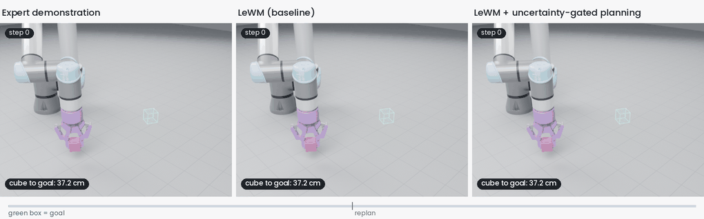
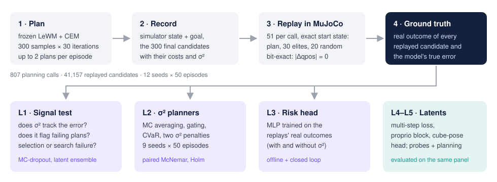
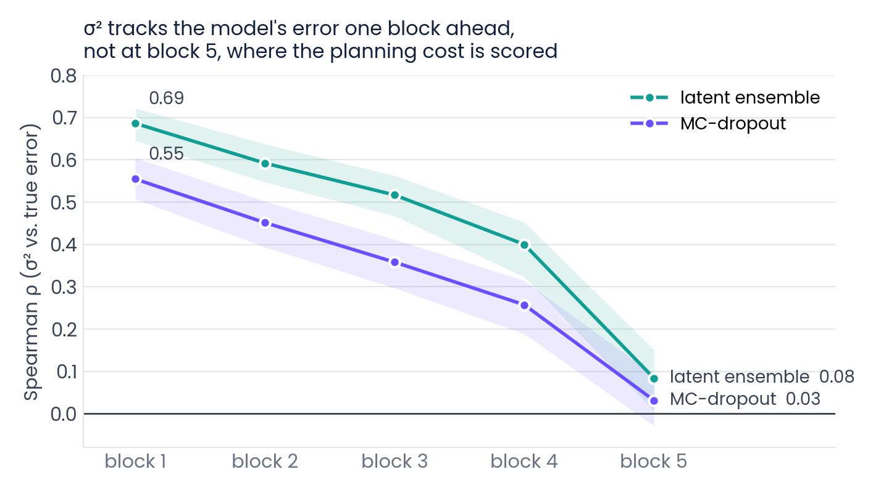
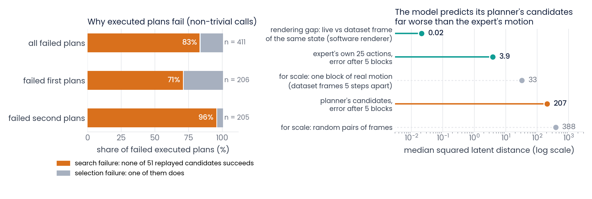
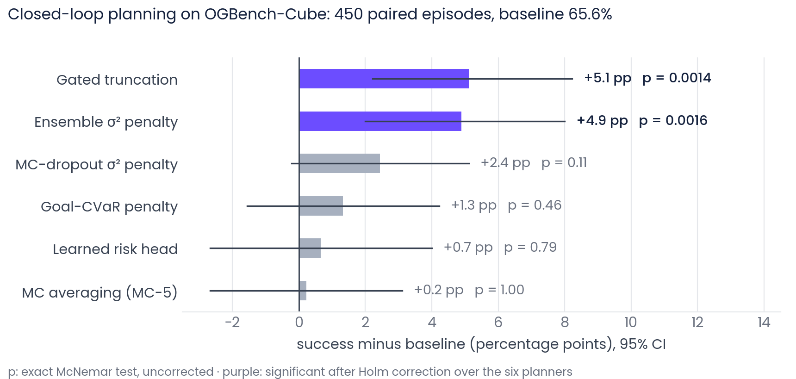
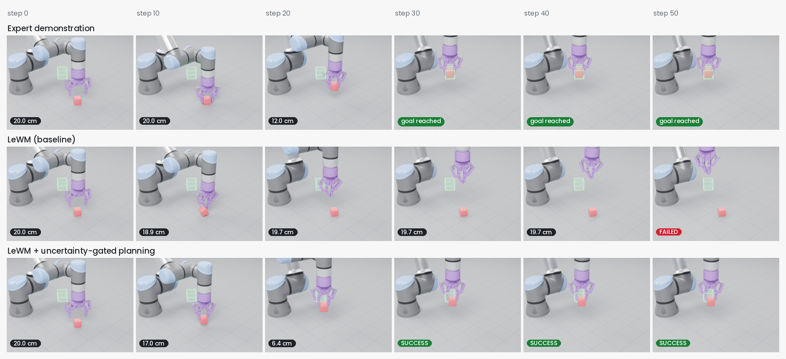
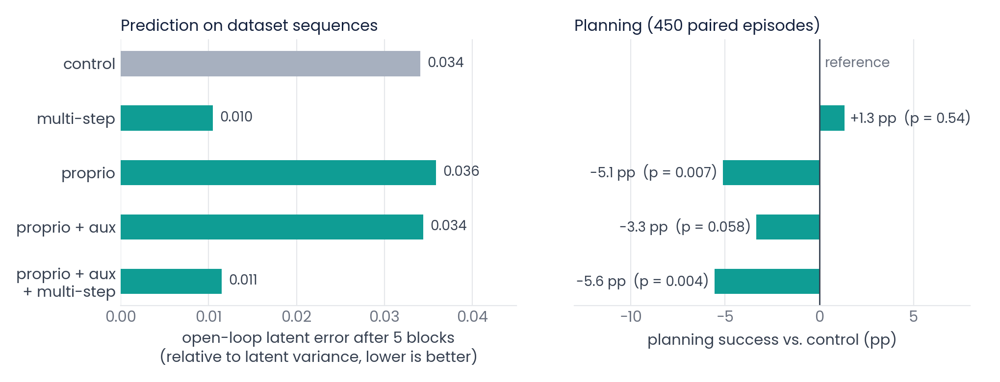
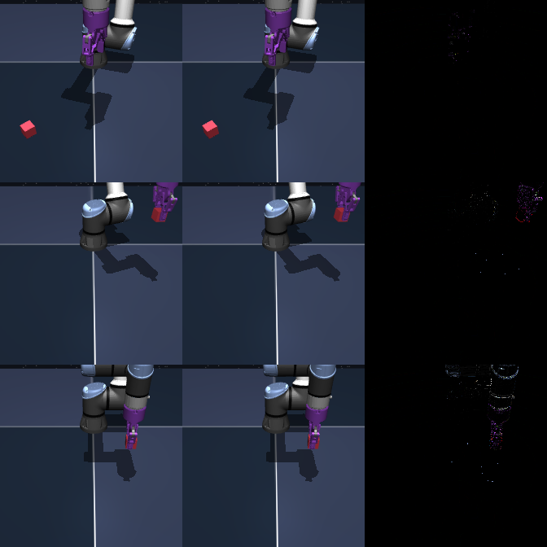

# Uncertainty-Aware Planning for LeWorldModel

**Does uncertainty help a latent world-model planner?** A ground-truth study of
[LeWorldModel](https://le-wm.github.io/) (LeWM) planning on OGBench-Cube
robot-arm pick-and-place.

<p align="center">
  
</p>

<sub><b>One test episode (seed 42, episode 31), replayed exactly from the
logged actions and rendered with Blender Cycles.</b> Left: the expert
demonstration; its state 25 steps ahead is the goal (green box). Middle:
LeWM's planner lets go of the cube at the start. Right: with
uncertainty-gated planning, the arm carries the cube to the goal by step 24.
The episode illustrates the difference; it does not measure it. Over all 450
test episodes, success is 65.6% for the baseline and 70.7% with gating
(p = 0.0014). How the examples were chosen:
<a href="results/cube/viz/README.md">results/cube/viz</a>.</sub>

<p align="center">
  <a href="results/cube/RESULTS.md"><b>All result tables</b></a> ·
  <a href="results/cube/viz/README.md"><b>Videos</b></a> ·
  <a href="cluster/README.md"><b>Running on Slurm</b></a>
</p>

## Findings at a glance

LeWM plans with the cross-entropy method (CEM). It searches for action
sequences whose *predicted* final latent lies closest to the latent of a goal
image. If plans fail because the planner exploits model errors, an
uncertainty-aware planner should help. On PushT it did not: three such
planners (MC averaging, gated truncation, a CVaR penalty) gained at most 2.2
points (p > 0.1). We tested the premise on Cube, against ground truth from the
simulator.

| | finding | evidence |
|---|---|---|
| 1 | **σ² tracks the model's error one block ahead, not where the plan is scored** | Spearman ρ from block 1 to block 5: ensemble 0.69 → 0.08, MC-dropout 0.55 → 0.03 |
| 2 | **σ² cannot pick the good plan among CEM's final candidates** | within a planning call, AUROC for failing elites 0.52 (ensemble) and 0.49 (MC-dropout); re-ranking by cost + λσ² (ensemble): 29.7% plan success vs 30.0% |
| 3 | **Most failures are search failures** | 83% of failed plans: none of the 51 replayed candidates succeeds |
| 4 | **The search proposes actions the model predicts poorly** | median 5-block error 207 on the planner's candidates vs 3.9 on the expert's actions (overlapping but different states); a rendering gap is ruled out |
| 5 | **σ² can help when it shapes the search** | two of the four planners that put σ² into CEM's objective: gated truncation +5.1 pp (p = 0.0014), ensemble σ² penalty +4.9 pp (p = 0.0016), both significant after Holm correction |
| 6 | **Better prediction is not better planning** | multi-step loss: open-loop error 3.2× lower, success +1.3 pp (n.s.); proprio-factorised latents −3.3 to −5.6 pp |

## How we measured it

<p align="center">
  
</p>

- **Record.** Every CEM call of the frozen LeWM stores the simulator state, the
  goal, and the executed plan with the 300 final candidates, their predicted
  costs and σ². 51 of them are replayed: the executed plan, the 30 elites and
  20 random others.
- **Replay.** `cube/oracle.py` restores the exact simulator state and executes
  each candidate. Mid-episode exactness needs more than joint positions and
  velocities: the solver's warm start and the controller's cached
  end-effector pose as well. With them, the replays of the executed plans
  match the closed-loop runs bit for bit (max |Δqpos| = 0 over 412 plans), and
  the oracle reproduces all 600 episode outcomes.
- **Two uncertainty signals.** The variance of the frozen predictor's
  rollouts across 8 MC-dropout masks (the MC planners use 5), and the
  disagreement of a five-member latent dynamics ensemble trained on the frozen
  encoder (`ua/ensemble.py`).
- **Protocol.** The LeWM paper's Cube setup: 50 episodes per seed, goal = the
  expert's state 25 steps ahead, CEM with 300 samples × 30 iterations
  (top 30), horizon 5 blocks of 5 env steps, success = cube within 4 cm of the
  goal. Test seeds 42–45, 1011, 2022, 3033, 4044 and 5055. Every planner sees
  the same start and goal states, so all comparisons are paired (exact
  McNemar test on 450 episodes).

## Results

### 1 · σ² is a short-horizon signal (L1)

<table>
  <tr>
    <td width="62%"></td>
    <td width="38%"></td>
  </tr>
</table>

- **Short horizons only.** Both signals rank the model's real prediction error
  well at the first block and barely at the fifth, where CEM scores a
  candidate (586 non-trivial planning calls with 29,886 replayed candidates;
  plan-bootstrap 95% CI). The ensemble is the better signal at every block.
- **Not within a planning call.** Where CEM chooses, neither signal separates
  the elites that fail from those that succeed: within-plan AUROC 0.49
  (MC-dropout) and 0.52 (ensemble). Adding σ² to the cost in a
  cross-validated failure model changes the AUROC by less than 0.01.
- **Across problems, it does carry information** (right). Episodes whose
  first plan has a high σ² almost all fail, so σ² could serve abstention or
  hand-off, rather than the choice between plans.

### 2 · Most failures are search failures (L1)

<p align="center">
  
</p>

- **Selection is not the main problem.** 83% of the failed executed plans are
  *search failures*: none of the 51 replayed candidates (the plan, 30 elites
  and 20 random ones) succeeds. After a failed first plan, the second plan
  almost never recovers. A perfect selector among the replayed candidates
  would raise plan success only from 30% to 41%.
- **Re-ranking does not help.** Re-scoring the candidates with cost + λσ²
  (ensemble, λ selected on calibration seeds) picks plans that succeed 29.7%
  of the time, against 30.0% for the plan the baseline executed. A risk head
  trained on 54,825 replays predicts failure well across calls (test AUROC
  0.87) and does not help either.
- **The model is wrong where the planner searches.** It predicts the
  planner's candidates far worse than the expert's own motion: a median
  5-block error of 207 against 3.9 (over overlapping but different sets of
  states). For failed plans, the true cost exceeds the predicted one by a
  median of 252, against 45.5 for successful plans: the model expected its
  failed plans to work. This is consistent with the optimizer's curse, though
  we did not compare selected with unselected candidates.
- **Not a rendering artefact.** Live-rendered frames encode like the
  dataset's frames: a latent distance of 0.01 with the hardware renderer and
  0.02 with the software one, against 32.8 for one block of motion
  ([results/cube/diag](results/cube/diag/domain_gap.md)).

### 3 · Uncertainty can help when it shapes the search (L2, L3)

<p align="center">
  
</p>

| planner | how the planner changes CEM's score | success (%) | Δ (pp) | McNemar p | Holm p |
|---|---|---:|---:|---:|---:|
| baseline (LeWM) | ‖ẑ₅ − z_goal‖², one rollout | 65.6 ± 6.0 | – | – | – |
| MC-5 | mean of 5 MC-dropout rollouts | 65.8 ± 5.2 | +0.2 | 1.00 | 1.00 |
| **gated truncation** | MC-5; high first-block σ² → scored at an earlier block | **70.7 ± 4.8** | **+5.1** | **0.0014** | **0.008** |
| Goal-CVaR | MC-5 + CVaR penalty on the worst dropout samples | 66.9 ± 5.7 | +1.3 | 0.46 | 1.00 |
| σ² penalty (MC-dropout) | MC-5 + λ σ²₅ | 68.0 ± 6.2 | +2.4 | 0.11 | 0.43 |
| **σ² penalty (ensemble)** | cost + λ σ²₅ of the ensemble | **70.4 ± 6.1** | **+4.9** | **0.0016** | **0.008** |
| learned risk head (L3) | cost + predicted error, MLP trained on the replays | 66.2 ± 7.1 | +0.7 | 0.79 | 1.00 |

<sub>Mean ± std over 9 test seeds × 50 episodes; Δ and p are paired over the
450 episodes; Holm correction over the six planners.</sub>

- **Two planners gain about 5 points**, both significant after correction.
  On the non-trivial episodes (cube not already at the goal), both gain 7–8
  points.
- **The gain most likely comes through the search.** Used only to re-rank
  the baseline's final candidates, the ensemble score does not help (29.7% vs
  30.0%). Inside CEM, where it shapes the elites of all 30 iterations, it adds
  7.3 points on the non-trivial episodes. The comparison is approximate (plans
  vs episodes, 51 of the 300 final candidates), and we did not record these
  planners' searches, but it points to the candidates the modified search
  produces.
- **The gate rarely truncates** (mean scored horizon 4.86 of 5 blocks) and reads
  MC-dropout σ² at block 1, where that signal is strongest.

<p align="center">
  
</p>

<sub><b>Seed 2022, episode 22</b>, columns every 10 env steps. The baseline's
gripper moves on without the cube and fails 19.7 cm from the goal; the gated
planner carries it into the goal box (success at step 22). Selected the same
way as the episode at the top. MP4s of five episodes: <code>results/cube/viz/out/</code>.</sub>

### 4 · Better prediction is not better planning (L4, L5)

<p align="center">
  
</p>

Five variants of LeWM, each warm-started from the pretrained model and
trained for 20,000 steps under the same recipe:

| variant | change | 5-block open-loop error (rel. to latent variance) | success (%) | Δ vs control (p) |
|---|---|---:|---:|---:|
| `lewm` (control) | LeWM retrained under our budget | 0.034 | 66.7 ± 7.3 | – |
| `ms` | + 5-block rollout loss (the planner's rollout) | **0.010** | 68.0 ± 5.8 | +1.3 (0.54) |
| `prop` | z = [z_vis ; z_prop] with a proprio MLP, plus a de-redundancy penalty | 0.036 | 61.6 ± 7.9 | −5.1 (0.007) |
| `prop_aux` | + training-only cube-pose head | 0.034 | 63.3 ± 8.1 | −3.3 (0.058) |
| `prop_ms` | all of the above | 0.011 | 61.1 ± 7.6 | −5.6 (0.004) |

- **Multi-step training does what it targets.** It cuts the open-loop error
  on dataset sequences 3.2-fold and the decoded cube error from 1.51 to
  1.19 cm, yet planning success rises by only 1.3 points (n.s.). The errors
  that matter are on the planner's candidates (§2 above), and a loss on
  dataset sequences need not reduce them.
- **The factorised latents encode what was missing, and plan worse.** The
  proprio block makes joint velocity decodable (MLP probe r 0.07 → 0.89) and
  the cube-pose head makes yaw linearly decodable (0.23 → 0.97). Yet all three
  variants plan worse than the control, two of them significantly. One
  plausible contributor: the
  de-redundancy penalty also strips linearly decodable cube position from
  z_vis (linear r 0.996 → 0.29), because the cube moves with the gripper. It
  does not explain everything.

### 5 · Checks

<table>
  <tr>
    <td width="34%"></td>
    <td>
      <b>Rendering.</b> Each row: a dataset frame, the live render of the same
      state, and their difference (×4), for the best, median and worst of 100
      evaluation start states. These 224×224 frames are what the encoder
      sees. Latent distance between the two: 0.01 (hardware renderer) and
      0.02 (software renderer on MIG slices), against 32.8 for one block of
      motion and 388 for random pairs.<br><br>
      <b>Replays.</b> Bit-exact for 412 executed plans (207 at an episode
      start, 205 mid-episode); the oracle's outcome equals the closed-loop
      outcome in 600 of 600 episodes.<br><br>
      <b>Noise floor.</b> Re-running the same planner on the same seeds
      changed 20 of 300 episode outcomes (up to 8 of 50 per seed), so single
      50-episode runs say little; every comparison pairs 450 episodes.<br><br>
      <b>Baseline gap.</b> Our baseline (65.6%, CI 61.1–69.8) is below the
      published 74%, with the released checkpoint and configuration. Rendering
      is not the cause; we have not found what is. All comparisons are within
      our own panel.
    </td>
  </tr>
</table>

## What would help next

The evidence points at the search distribution and the data the model sees:

- **Keep the search near the data**: σ² inside the search (the ensemble
  signal worked best), a goal-conditioned behaviour-cloning prior to start CEM
  (GCBC alone reaches 84% on Cube), or temporally correlated sampling noise.
- **Train on the planner's own candidates**: the 41k replays are exactly such
  data, with true latents and outcomes (in the spirit of DAgger).
- **Use σ² for what it can do on its own**: its high values flag problems the
  planner will not solve, which suits abstention, hand-off or more frequent
  replanning.

## Repository map

| level | question | main code | output in `results/cube/` |
|---|---|---|---|
| L0 | protocol, data, checkpoint | `config/eval/cube.yaml`, `scripts/cube/download_assets.py` | `smoke/` |
| L1 | does σ² flag the plans that fail? | `cube/recording.py`, `cube/oracle.py`, `train_ensemble.py`, `scripts/cube/analyze_signal.py` | `l1/signal_report.md` |
| L2 | σ² planners in closed loop | `ua/`, `config/eval/method/*.yaml` | `summary/l2_panel.md` |
| L3 | a risk head learned from the replays | `ua/risk.py`, `scripts/cube/train_risk_head.py` | `l3/`, `summary/planning_panel.md` |
| L4 | representation variants | `train_cube.py`, `cube/variants.py` | `l4/` (training curves; checkpoints stay on the cluster) |
| L5 | probes, open-loop error, planning | `scripts/cube/eval_representation.py` | `l5/`, `summary/variants_vs_control.md` |
| L6 | every result in one place | `scripts/cube/make_report.py` | `RESULTS.md` |
| check | live-rendered vs dataset frames | `scripts/cube/check_domain_gap.py` | `diag/`, `diag_hw/` |
| videos | replay and render rollouts | `scripts/cube/viz_*.py` | `viz/` |

| path | role |
|---|---|
| `evaluate.py` | planning evaluation: `python evaluate.py --config-name cube method=<planner> seed=<n>` (`evaluate_wm.py` evaluates the world model itself) |
| `planners.py` | builds the planner for `cfg.method` |
| `ua/` | MC-dropout σ² (`uncertainty.py`), latent ensemble (`ensemble.py`), gated truncation (`truncation.py`), MC planner (`ua_jepa.py`), Goal-CVaR (`goal_cvar.py`), risk head (`risk.py`) |
| `cube/` | everything Cube-specific: recorder, exact simulator state, oracle, rollout logger, L4 variants and clip loader, metrics |
| `cluster/` | the Slurm pipeline: `submit.sh` (one command per phase), job scripts, environment setup |
| `docs/figures/` | the README figures (`scripts/cube/make_readme_figures.py`) |
| `tests/` | unit tests on synthetic Cube data |
| `train.py`, `jepa.py`, `module.py`, `utils.py`, `config/train/` | LeWM training code (upstream, unchanged) |
| `stable-worldmodel/`, `stable-pretraining/` | upstream environments, CEM solver and trainer (git submodules) |

## Reproducing

### Cube experiments (Slurm)

The full pipeline runs as Slurm jobs; [`cluster/README.md`](cluster/README.md)
covers the one-time setup, GPU types and troubleshooting. From the repository
root on the login node:

```bash
bash cluster/submit.sh bootstrap   # conda env, dataset + checkpoint (quentinll/lewm-cube), smoke test
bash cluster/submit.sh planning    # L1 -> L2 -> L3: recording, replays, ensemble, planners, risk head
bash cluster/submit.sh l4          # L4 training; each variant's L5 evaluation starts when it finishes
bash cluster/submit.sh report      # L6: results/cube/RESULTS.md
bash cluster/submit.sh diag-hw     # rendering check on a whole GPU (diag: the same on any GPU)
bash cluster/submit.sh viz         # re-runs that save the executed actions, for the videos
bash cluster/submit.sh status      # progress; `results` commits and pushes the small result files
```

Every phase can be submitted again: finished runs are skipped. Single runs:

```bash
python evaluate.py --config-name cube method=baseline seed=42
# record every CEM call as well, for the oracle replays
python evaluate.py --config-name cube method=baseline seed=42 record.enabled=true
# a planner with the Cube parameters the panel used (here the gate's threshold and ω)
read thr omega < <(python scripts/cube/l2_params.py gated)
python evaluate.py --config-name cube method=gated seed=42 \
    method.truncation.threshold=$thr method.truncation.omega=$omega
```

The defaults in `config/eval/method/*.yaml` are the PushT settings; the Cube
parameters of every planner come from `scripts/cube/l2_params.py` and
`results/cube/l3/risk_selection.json`, which `cluster/runs.sh` passes on in the
same way.

### Figures, tables and videos (no GPU, no dataset)

```bash
python scripts/cube/make_readme_figures.py   # docs/figures/*.png from results/cube/
python scripts/cube/make_report.py           # results/cube/RESULTS.md (the L4 training
                                             # table also needs the logs in $STABLEWM_HOME)
```

The rollout videos replay the logged actions in MuJoCo and render them with
Blender's Python module (`bpy==4.2.0`, Python 3.11); the three commands are in
[`cluster/README.md`](cluster/README.md#rollout-videos-baseline-vs-gated-planning).

### Tests

```bash
PYTHONPATH=.:stable-worldmodel:stable-pretraining pytest -q tests/
```

### Environment

`stable-worldmodel/` and `stable-pretraining/` are git submodules pinned to
the upstream commits used for all experiments. The Cube experiments use the
package set in `cluster/requirements-cluster.txt` (installed by
`cluster/setup_env.sh`); the PushT pilot used `requirements.txt`:

```bash
git clone --recurse-submodules https://github.com/JaspinXu/uncertainty-aware-lewm.git
cd uncertainty-aware-lewm
pip install -r requirements.txt --extra-index-url https://download.pytorch.org/whl/cu128
export STABLEWM_HOME="$PWD"     # checkpoints/ and datasets/ live here
export PYTHONPATH="$PWD:$PWD/stable-worldmodel:$PWD/stable-pretraining:$PYTHONPATH"
export MUJOCO_GL=egl
```

## The PushT pilot

The project started from a PushT study with the same frozen-model design: the
pretrained LeWM checkpoint (`checkpoints/pusht/lewm`) and the CEM planner stay
fixed, and only the trajectory-scoring rule changes.

| planner | config | scoring rule | success (9 seeds × 50) | Δ (pp) | McNemar p |
|---|---|---|---:|---:|---:|
| baseline | `method=baseline` | one deterministic rollout, terminal latent distance | 87.3 ± 3.5 | – | – |
| MC-5 | `method=mc5` | mean of 5 MC-dropout rollouts | 89.6 ± 4.0 | +2.2 | 0.13 |
| gated, N = 5 | `method=gated` | MC-5 + horizon truncation when step-0 σ² exceeds a calibrated threshold | 88.9 ± 4.7 | +1.6 | 0.27 |
| Goal-CVaR, α = 0.1 | `method=goal_cvar` | MC-5 + CVaR soft penalty on the worst dropout samples | 88.7 ± 4.1 | +1.3 | 0.42 |

<details>
<summary><b>Reproducing the PushT panel, and how its configuration was chosen</b></summary>

Data: download `pusht_expert_train` from the
[LeWM HuggingFace collection](https://huggingface.co/collections/quentinll/lewm)
to `$STABLEWM_HOME/datasets/pusht_expert_train.h5`. The checkpoint is in the
repository (`checkpoints/pusht/lewm/`). All runs: CEM 300 candidates /
30 iterations / top 30, receding horizon 5.

**1. Gated-threshold calibration** (only needed to re-calibrate):

```bash
python scripts/calibrate_gated_threshold.py method=mc5 seed=910 +num_eval=8 \
    +output_filename=gated_lewm_strong_rh5.json
```

It records the step-0 σ² of every CEM candidate over 8 episodes and writes
`results/calibration/gated_lewm_strong_rh5.json`; the gate threshold is its
`recommended_threshold` (the σ² median, 0.2535), stored in
`config/eval/method/gated.yaml`.

**2. Locked 9-seed panel:**

```bash
bash scripts/run_locked_panel.sh            # 4 methods x 9 seeds; finished runs are skipped
python scripts/summarize_locked_9seeds.py   # the table above; also writes results/combined_9seeds.md
```

**Single runs:**

```bash
bash scripts/run_single.sh METHOD SEED [hydra overrides...]
#   METHOD: baseline | mc5 | gated | goal_cvar
#   env:    NUM_EVAL=50 CEM_SAMPLES=300 CEM_STEPS=30 CEM_TOPK=30 REC_HORIZON=5 POLICY=pusht/lewm RUN_ID FORCE=1
python evaluate.py method=goal_cvar seed=42 method.alpha=0.25 output.run_id=goal_a0p25_s42
```

`run_single.sh` writes `results/<run_id>.txt` (resolved config and metrics,
including per-episode successes) and the log `results/logs/<run_id>.log`.

**How the configuration was chosen** (run once; the scripts and intermediate
results have since been removed, so this is a record only). Historical ids:
`mc_only_n5` = `mc5`, `gated_n5` = `gated`, `adaptive_n5` = ungated adaptive
truncation.

1. *Replanning frequency*: validation seeds 61–63, cheap CEM (100/20/20),
   receding horizon ∈ {5, 2, 1}; the highest mean baseline success selected
   **5**.
2. *Gated-threshold calibration*: step 1 above.
3. *Strong-CEM validation*: seeds 61–63, CEM 300/30/30, `baseline`,
   `mc_only_n5`, `adaptive_n5`, `gated_n5` (ω = 1.0); **gated_n5** had the
   higher mean success.
4. *Locked test*: seeds 1011–5055, fixed in advance and never used for
   selection.

α = 0.1 for Goal-CVaR was screened over {0.1, 0.25, 0.5} on validation seeds
74/75 (n = 20, CEM 100/20/20). Its later strong-validation gate (seeds 74–76,
n = 50, CEM 300/30/30) did not pass (−0.67 pp vs MC), so that protocol's own
final seeds were never run; α = 0.1 was instead evaluated on the locked panel
alongside the other methods.

</details>

## Training (upstream LeWM)

```bash
python train.py data=pusht     # config/train/lewm.yaml
```

## References

- L. Maes, Q. Le Lidec, D. Scieur, Y. LeCun, R. Balestriero. *LeWorldModel*. [arXiv:2603.19312](https://arxiv.org/abs/2603.19312), 2026. [Project page](https://le-wm.github.io/) · [checkpoints](https://huggingface.co/collections/quentinll/lewm)
- S. Park, K. Frans, B. Eysenbach, S. Levine. *OGBench: Benchmarking Offline Goal-Conditioned RL*. ICLR 2025.
- G. Zhou, H. Pan, Y. LeCun, L. Pinto. *DINO-WM: World Models on Pre-trained Visual Features enable Zero-shot Planning*. ICML 2025.
- K. Chua, R. Calandra, R. McAllister, S. Levine. *Deep Reinforcement Learning in a Handful of Trials using Probabilistic Dynamics Models*. NeurIPS 2018.
- Y. Gal, Z. Ghahramani. *Dropout as a Bayesian Approximation*. ICML 2016.
- B. Lakshminarayanan, A. Pritzel, C. Blundell. *Simple and Scalable Predictive Uncertainty Estimation using Deep Ensembles*. NeurIPS 2017.
- T. Yu et al. *MOPO: Model-based Offline Policy Optimization*. NeurIPS 2020.
- J. E. Smith, R. L. Winkler. *The Optimizer's Curse*. Management Science, 2006.
- S. Ross, G. Gordon, D. Bagnell. *A Reduction of Imitation Learning and Structured Prediction to No-Regret Online Learning* (DAgger). AISTATS 2011.
