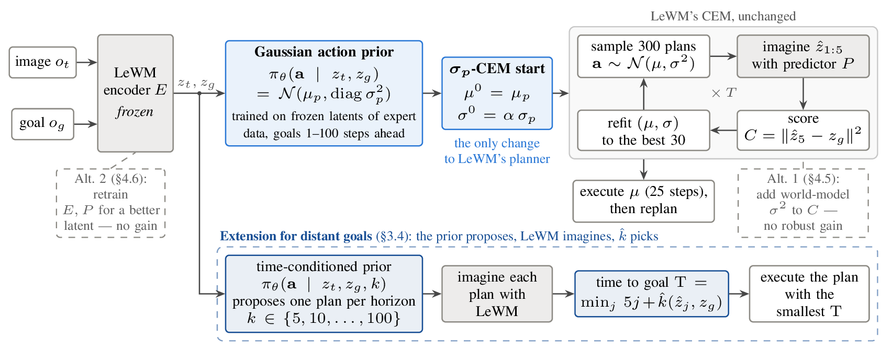
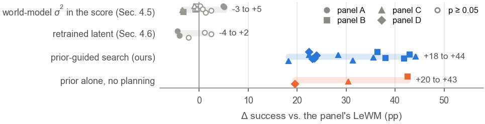

# Put Uncertainty in the Search, Not the Score: Prior-Guided CEM for a Frozen LeWorldModel

Code, per-episode results and run instructions of the CS5478 final project of
Team 16 (Zhaobin Xu, Liwei Yuan, Junping Li), National University of Singapore.
This branch (`final`) merges the three working branches (`main`, `ylw`, `ljp`)
into one code base that reproduces every table and figure of the final report.

[LeWorldModel](https://le-wm.github.io/) (LeWM) plans with the cross-entropy
method (CEM), but on OGBench-Cube pick-and-place its planner falls behind a
behaviour-cloning policy that does not plan. A bit-exact replay of 41,157
candidate plans shows why: 83% of LeWM's failed plans are **search** failures
(no candidate CEM considered succeeds), and CEM returns the plans whose cost
LeWM underestimates most. Our method therefore changes where CEM searches and
leaves the world model, its cost and the CEM update untouched.

<p align="center">
  
</p>

- **σₚ-CEM (main method).** A Gaussian goal-conditioned action prior
  π(a | z_t, z_g) = N(μₚ, σₚ²), trained in minutes on frozen LeWM latents of the
  expert data (goals 1–100 steps ahead), sets CEM's initial distribution to
  μ⁰ = μₚ, σ⁰ = α·σₚ. The search is narrow where the prior is confident, which
  keeps candidates where LeWM's predictions are accurate, and wide where it is
  not. One hyper-parameter (α = 0.1, chosen on separate tuning seeds).
- **Time-to-goal selection (extension for distant goals).** A time-conditioned
  prior proposes one plan per horizon k ∈ {5, 10, 15, 25, 35, 50, 75, 100};
  LeWM imagines each; a steps-to-goal estimate k̂ (expectile regression)
  picks the plan with the smallest min_j (5j + k̂(ẑ_j, z_g)).
- **BC-guided CEM** (`action-prior/`) is the simplest instance: 25% of CEM's
  first-iteration candidates around a point prior's proposal, with a fixed width.

## Results at a glance

Success (%) on held-out start states (500 episodes per panel; exact McNemar
tests on paired episodes in [`results/cube/compare/k25/summary.md`](results/cube/compare/k25/summary.md)
and [`k50/summary.md`](results/cube/compare/k50/summary.md)):

| planner | panel B: goal 25 steps ahead | panel C: goal 50 steps ahead |
|---|---:|---:|
| LeWM (CEM) | 56.4 | 41.8 |
| + σ² gated truncation (alternative 1) | 55.8 | 41.4 |
| prior alone, no planning | 99.0 | 72.2 |
| prior + CEM, constant width | 98.2 | 73.2 |
| **σₚ-CEM** | **99.4** | 77.4 |
| **+ time-to-goal selection** | 92.8 | **86.0** |

- On 50-step goals σₚ-CEM beats the same search with a constant width by
  4.2 points (p = 3×10⁻⁴) and the prior alone by 5.2 (p = 0.005); time-to-goal
  selection adds another 8.6 points. On 25-step goals the prior alone is
  already at 99%.
- Panel D: BC-guided CEM 95.6% against 72.4% for the original CEM at
  5 iterations, and the original CEM does not improve with 30 iterations
  ([`action-prior/README.md`](action-prior/README.md#results)).
- The two alternative directions, putting the world model's σ² into CEM's
  score and retraining a better latent, change success by −4.4 to +5.1 points,
  and their gains do not replicate on held-out panels:

<p align="center">
  
</p>

## Where things are

| report | code | results |
|---|---|---|
| §3.2 Gaussian action prior | `ua/step1/prior.py` (`BCPrior`, `train_prior`), `scripts/cube_train.py` | `results/cube/compare/models/split.json` (weights are not committed) |
| §3.3 σₚ-CEM | `ua/step1/prior.py` (`PriorInitCEMSolver`, `init_std="prior"`, `std_scale` = α), planners in `scripts/cube_compare.py` | `results/cube/compare/k25/`, `k50/` |
| §3.4 time-to-goal selection | `ua/step1/prior.py` (`PriorSelectSolver`, `time_to_goal`), `ua/step1/steps_to_goal.py` (k̂) | `results/cube/compare/k50/bc_select_khat*/` |
| §3.4 BC-guided CEM, panel D | `action-prior/` (own README and `docs/REPRODUCE.md`) | `action-prior/results/` |
| §4.1 panels B, C, T | `config/eval/compare.yaml`, `scripts/run_cube_compare.sh`, `scripts/cube_compare_summary.py` | `results/cube/compare/k*/summary.md`, `results/cube/compare_tune/k50/summary.md` |
| §4.2 diagnosis (replay oracle) | `cube/recording.py`, `cube/oracle.py`, `scripts/cube/analyze_signal.py`, `scripts/step1_*.py` | `results/cube/l1/signal_report.md`, `results/cube/step1/` |
| §4.5 alternative 1: σ² in the score | `ua/` (`uncertainty.py`, `ensemble.py`, `truncation.py`, `goal_cvar.py`, `risk.py`), `config/eval/method/*.yaml` | `results/cube/summary/planning_panel.md` |
| §4.6 alternative 2: retrained latents | `train_cube.py`, `cube/variants.py`, `scripts/cube/eval_representation.py` | `results/cube/l4/`, `l5/`, `summary/variants_panel.md` |
| Figures 2–5 | `scripts/make_report_figures.py` | `docs/figures/paper/` |
| Figure 1 | `docs/figures/method_flow.tex` (TikZ) | `docs/figures/method.png` |

Other paths: `evaluate.py` (planning evaluation), `planners.py` (builds a
planner from the config), `cube/` (Cube-specific recorder, oracle, variants),
`cluster/` (Slurm pipeline of panel A), `tests/` (unit tests),
`train.py`, `jepa.py`, `module.py`, `utils.py` (upstream LeWM training code),
`stable-worldmodel/`, `stable-pretraining/` (upstream environments, CEM solver
and trainer, as git submodules).

## Setup

```bash
git clone -b final --recurse-submodules https://github.com/LiJunping11/uncertainty-aware-lewm.git
cd uncertainty-aware-lewm
conda create -y -n lewm python=3.11 && conda activate lewm
pip install -r cluster/requirements-cluster.txt
pip install --no-deps -e ./stable-worldmodel -e ./stable-pretraining

export STABLEWM_HOME="$PWD"   # checkpoints/ and datasets/ live here
export PYTHONPATH="$PWD:$PWD/stable-worldmodel:$PWD/stable-pretraining:$PYTHONPATH"
export MUJOCO_GL=egl          # glfw on macOS
python scripts/cube/download_assets.py   # LeWM Cube checkpoint (72 MB) + OGBench-Cube dataset (46 GB archive)
```

The checkpoint lands in `$STABLEWM_HOME/checkpoints/cube/lewm/`, the dataset in
`$STABLEWM_HOME/datasets/ogbench/cube_single_expert.h5`
(`--only model` or `--only data` fetches one of them). On a Slurm cluster,
`bash cluster/submit.sh bootstrap` does all of this
([`cluster/README.md`](cluster/README.md)).

## Reproducing

### Main results: panels B and C (Table 1, Figure 3a)

`scripts/run_cube_compare.sh` trains the learned components on frozen
latents (`scripts/cube_train.py`: the priors and k̂, minutes each), evaluates
every planner in `METHODS` on 10 seeds × 50 held-out non-trivial episodes, and
writes `results/cube/compare/k<OFFSET>/summary.md`. Finished seeds are
skipped, so it can be re-run after an interruption.

```bash
# panel C: goal 50 steps ahead (budget 100 steps)
OFFSET=50 STAGES="train eval summary" \
  METHODS="lewm bc_only_var prior_cem_sconst_var_a01 prior_cem_sp_var_a01 bc_select_khat" \
  bash scripts/run_cube_compare.sh

# panel B: goal 25 steps ahead (budget 50 steps)
OFFSET=25 STAGES="train eval summary" \
  METHODS="lewm bc_only prior_cem_s1 prior_cem_sconst prior_cem_sp bc_select_khat" \
  bash scripts/run_cube_compare.sh
```

The σ² planners of the held-out panels (`mc5 gated gated_tc`) also need the
`calibrate` stage, which sets their thresholds on calibration seeds 900–901
(the default `STAGES` runs it). On a Slurm cluster, `scripts/submit_cube_compare.sh`
submits one job per method (`OFFSET=50 bash scripts/submit_cube_compare.sh`),
and `STAGES=summary bash scripts/run_cube_compare.sh` writes the summary when
they are done. One method on one seed: `python scripts/cube_compare.py
+planner=prior_cem_sp_var_a01 compare.offset=50 "+seeds=[0]"`.

### Tuning panel T (choice of α, Figure 3b)

```bash
bash scripts/submit_cube_tune.sh   # seeds 100-104, written to results/cube/compare_tune
OFFSET=50 STAGES=summary EXTRA="compare.out_dir=results/cube/compare_tune \
  compare.models_dir=results/cube/compare/models" bash scripts/run_cube_compare.sh
```

The selection rule (best pooled success over the tuning seeds, ties to the
smaller value) was fixed in `scripts/submit_cube_tune.sh` before the runs.

### Planner names

| report | planner name(s) in `scripts/cube_compare.py` |
|---|---|
| LeWM (CEM); MC-5; gated truncation; per-block gate | `lewm`; `mc5`; `gated`; `gated_tc` |
| prior alone (offset-agnostic / single-offset prior) | `bc_only_var` / `bc_only` |
| prior + CEM with σ⁰ = 1 / constant width / σₚ-CEM (α = 1) | `prior_cem_s1[_var]` / `prior_cem_sconst[_var]` / `prior_cem_sp[_var]` |
| constant width and σₚ-CEM at α = 0.1; σₚ-CEM at α = 0.25, 0.5 | `prior_cem_sconst_var_a01`, `prior_cem_sp_var_a01`; `prior_cem_sp_var_a025`, `prior_cem_sp_var_a05` |
| time-to-goal selection: point prior / Gaussian prior, draws, ensemble penalty | `bc_select_khat` / `bc_select_khat_m1`, `_sp_m4`, `_sp_m16`, `_m1_ens`, `_sp_m4_ens` |
| CEM scored by the time to goal | `lewm_khat`, `prior_cem_sp_var_khat` |

`_var` planners use the offset-agnostic prior (goals 1–100 steps ahead); the
others use a prior trained for goals exactly `compare.offset` steps ahead.

### Panel D: BC-guided CEM (Figure 3c)

See [`action-prior/README.md`](action-prior/README.md) and
[`action-prior/docs/REPRODUCE.md`](action-prior/docs/REPRODUCE.md): own
environment lock, Cube and PushT drivers, 70 test records and demonstrations.

### Panel A: diagnosis and the alternatives (§4.2, §4.5, §4.6)

These ran as Slurm jobs; [`cluster/README.md`](cluster/README.md) covers the
setup, GPU types and troubleshooting.

```bash
bash cluster/submit.sh bootstrap   # conda env, dataset + checkpoint, smoke test
bash cluster/submit.sh planning    # recording, oracle replays, ensemble, sigma^2 planners, risk head
bash cluster/submit.sh l4          # latent variants; each variant's evaluation starts when it finishes
bash cluster/submit.sh report      # results/cube/RESULTS.md
bash cluster/submit.sh status      # progress
```

Single runs: `python evaluate.py --config-name cube method=baseline seed=42`
(add `record.enabled=true` to record every CEM call for the oracle). The Cube
parameters of every σ² planner come from `scripts/cube/l2_params.py` and
`results/cube/l3/risk_selection.json`; `config/eval/method/*.yaml` holds the
PushT defaults. The pre-registered σ² test of §4.2 is `bash scripts/run_step1.sh`
(protocol: [`docs/step1_preregistration.md`](docs/step1_preregistration.md)).
All result tables of this panel: [`results/cube/RESULTS.md`](results/cube/RESULTS.md);
rollout videos: [`results/cube/viz/README.md`](results/cube/viz/README.md).

### Figures and checks (no GPU, no dataset)

```bash
python scripts/make_report_figures.py     # Figures 2-5 -> docs/figures/paper/, and prints every number they show
cd docs/figures && pdflatex method_flow_standalone.tex   # Figure 1 (TikZ)
PYTHONPATH=.:stable-worldmodel:stable-pretraining pytest -q tests/
```

## The PushT pilot

The project started from a PushT study with the same frozen-model design (the
pretrained checkpoint `checkpoints/pusht/lewm` and the CEM planner stay fixed;
only the scoring rule changes). No σ² planner helped significantly:

| planner | config | success (9 seeds × 50) | Δ (pp) | McNemar p |
|---|---|---:|---:|---:|
| baseline | `method=baseline` | 87.3 ± 3.5 | – | – |
| MC-5 | `method=mc5` | 89.6 ± 4.0 | +2.2 | 0.13 |
| gated, N = 5 | `method=gated` | 88.9 ± 4.7 | +1.6 | 0.27 |
| Goal-CVaR, α = 0.1 | `method=goal_cvar` | 88.7 ± 4.1 | +1.3 | 0.42 |

<details>
<summary><b>Reproducing the PushT panel</b></summary>

Data: download `pusht_expert_train` from the
[LeWM HuggingFace collection](https://huggingface.co/collections/quentinll/lewm)
to `$STABLEWM_HOME/datasets/pusht_expert_train.h5`; the checkpoint is in the
repository. All runs: CEM 300 candidates / 30 iterations / top 30, receding
horizon 5.

```bash
python scripts/calibrate_gated_threshold.py method=mc5 seed=910 +num_eval=8 \
    +output_filename=gated_lewm_strong_rh5.json   # gate threshold (stored in config/eval/method/gated.yaml)
bash scripts/run_locked_panel.sh                  # 4 methods x 9 seeds; finished runs are skipped
python scripts/summarize_locked_9seeds.py         # the table above
bash scripts/run_single.sh METHOD SEED [hydra overrides...]   # METHOD: baseline | mc5 | gated | goal_cvar
```

The replanning frequency (5) and the gate were chosen on validation seeds
61–63, α = 0.1 for Goal-CVaR on seeds 74–75; the locked test seeds 1011–5055
were never used for selection.

</details>

## Training (upstream LeWM)

```bash
python train.py data=pusht     # config/train/lewm.yaml
```

## References

- L. Maes, Q. Le Lidec, D. Scieur, Y. LeCun, R. Balestriero. *LeWorldModel*. [arXiv:2603.19312](https://arxiv.org/abs/2603.19312), 2026. [Project page](https://le-wm.github.io/) · [checkpoints](https://huggingface.co/collections/quentinll/lewm)
- S. Park, K. Frans, B. Eysenbach, S. Levine. *OGBench: Benchmarking Offline Goal-Conditioned RL*. ICLR 2025.
- G. Zhou, H. Pan, Y. LeCun, L. Pinto. *DINO-WM: World Models on Pre-trained Visual Features enable Zero-shot Planning*. ICML 2025.
- T. Wang, J. Ba. *Exploring Model-based Planning with Policy Networks* (POPLIN). ICLR 2020.
- D. Ghosh et al. *Learning to Reach Goals via Iterated Supervised Learning*. ICLR 2021.
- I. Kostrikov, A. Nair, S. Levine. *Offline Reinforcement Learning with Implicit Q-Learning*. ICLR 2022.
- K. Chua, R. Calandra, R. McAllister, S. Levine. *Deep Reinforcement Learning in a Handful of Trials using Probabilistic Dynamics Models*. NeurIPS 2018.
- Y. Gal, Z. Ghahramani. *Dropout as a Bayesian Approximation*. ICML 2016.
- B. Lakshminarayanan, A. Pritzel, C. Blundell. *Simple and Scalable Predictive Uncertainty Estimation using Deep Ensembles*. NeurIPS 2017.
- J. E. Smith, R. L. Winkler. *The Optimizer's Curse*. Management Science, 2006.
- N. Lambert, B. Amos, O. Yadan, R. Calandra. *Objective Mismatch in Model-based Reinforcement Learning*. L4DC 2020.
