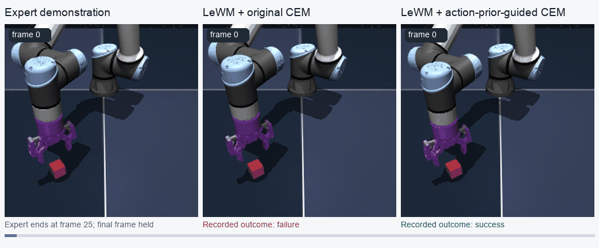
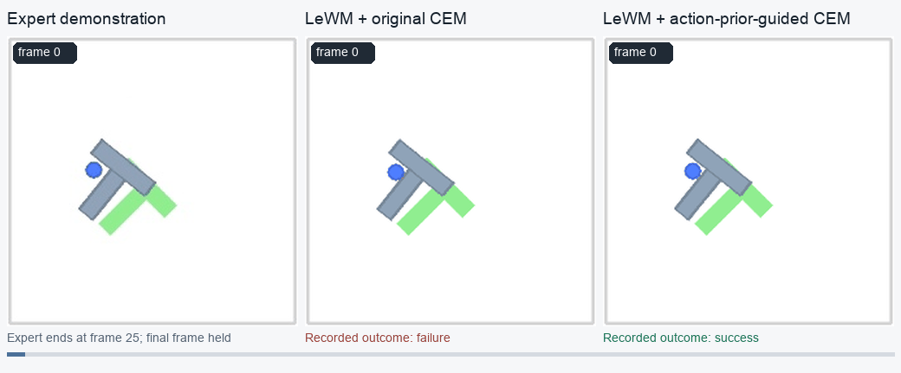

# Action-Prior-Guided CEM for LeWM

A planner-level extension to LeWM: a small goal-conditioned behavioral-cloning network proposes a reference action sequence, which guides the **first CEM iteration only**. The pretrained encoder, dynamics predictor, planning objective and later CEM updates are unchanged.

This repository contains the Cube and PushT experiments, source code, per-episode results, environment locks and real rollout demonstrations. It does **not** implement uncertainty-gated planning.

**Midterm scope:** these results measure short-horizon goal reaching from sampled trajectory states, not complete grasp–transport–release episodes. In particular, the reported 95.6% Cube success rate must not be presented as full pick-and-place success.

**Terminology:** action guidance is the proposed planning method; behavioral cloning (BC) is how its proposal network is trained. “Direct BC” in the tables is a separate ablation that bypasses world-model scoring and CEM refinement, not the proposed method.

## Demonstrations

Left: offline expert segment. Middle: original CEM. Right: action-prior-guided CEM. Each comparison uses the same task and planner seed, 5 CEM iterations and 300 candidates. These are deliberately selected success cases, not representative random samples.

### Cube



[MP4](assets/cube_expert_comparison.mp4) · Episode 1087, start 103, seed 62.

### PushT



[MP4](assets/pusht_expert_comparison.mp4) · Episode 12759, start 113, seed 62.

Recordings are played at 5 fps for readability, not real-time robot speed. Expert segments contain 26 frames; their final frame is held to match the 50-frame agent recording. Agent recordings can also hold after termination. The shared task is verified from evaluation manifests; frame counters are renderer-frame indices, not a claim of exact observation/action alignment. No synthetic trajectories, distance labels or extra actions are added. In PushT, the target is the **goal observation from the trajectory**, not necessarily the fixed green background silhouette.

## Method

1. Freeze LeWM. Encode the current image and the image 25 actions later in an offline trajectory.
2. Feed normalized current latent, goal latent and their difference to a two-hidden-layer MLP (256 units each). Train with action MSE to predict the intervening 25 actions.
3. For each planning call, initialize 75 of 300 candidates around this proposal, with noise standard deviation 0.5 in standardized action units. Keep 225 original-distribution candidates and explicitly include the noiseless proposal.
4. LeWM evaluates candidate outcomes using its original latent goal-distance objective. CEM fits the 30 elites and continues its original update rule. Execute through the original rolling action buffer.

The network predicts 5 action blocks of 5 actions. Cube actions have 5 dimensions; PushT actions have 2. The input uses one current latent, not an additional recurrent history encoder. Direct BC is a separate control that executes the proposal without model-based refinement.

| Component | Original CEM | Guided CEM |
|---|---|---|
| Initial candidates | Original sampling distribution | 25% proposal-guided, 75% original |
| Auxiliary training | None | Goal-conditioned BC |
| World model and cost | Pretrained LeWM | Same frozen model and cost |
| Subsequent iterations | Elite fitting and resampling | Same update rule |

The guidance fraction was selected on Cube validation trajectories: 0.25, 0.5, 0.75 and 1.0 tied at 100%; the prespecified tie-break chose the smallest fraction. This does not establish 0.25 as a unique optimum or prove that retaining random samples is necessary. PushT trains its own prior and reuses the Cube-selected guidance parameters.

## Results

Success rate in percent, mean ± sample standard deviation across five planner seeds. Each seed evaluates the **same 50 held-out trajectories**; this is not 250 independent tasks. “Original” means our matched original-CEM run, not a number copied from the paper.

| Task | CEM iterations | Original CEM | Guided CEM | Gain in percentage points |
|---|---:|---:|---:|---:|
| Cube | 5 | 72.4 ± 1.7 | **95.6 ± 0.9** | +23.2 |
| Cube | 10 | 72.8 ± 3.0 | **95.2 ± 1.1** | +22.4 |
| Cube | 20 | 71.6 ± 0.9 | **95.2 ± 1.1** | +23.6 |
| Cube | 30 | 70.8 ± 3.0 | **94.8 ± 2.3** | +24.0 |
| PushT | 5 | 70.0 ± 2.8 | **89.6 ± 2.6** | +19.6 |
| PushT | 30 | 93.6 ± 3.0 | **96.4 ± 1.7** | +2.8 |

Direct BC: **92.0 ± 0.0% on Cube**, **59.6 ± 0.9% on PushT**.

| Task | Iterations | Original batched solve seconds | Guided batched solve seconds |
|---|---:|---:|---:|
| Cube | 5 | 4.12 | 3.36 |
| Cube | 10 | 7.64 | 6.54 |
| Cube | 20 | 15.42 | 12.49 |
| Cube | 30 | 22.56 | 17.91 |
| PushT | 5 | 4.73 | 3.62 |
| PushT | 30 | 18.35 | 17.58 |

Timing includes proposal inference and CUDA synchronization but excludes environment stepping. Active batch sizes change after early success, so these are **not single-robot latency estimates** or isolated compute-speedup measurements.

### What the results support

- At 5 iterations, paired trajectory-bootstrap 95% confidence intervals for gains over original CEM are **[12.8, 34.8] pp on Cube** and **[8.4, 30.4] pp on PushT**.
- PushT at 30 iterations has a smaller gain with interval **[-1.2, 7.6] pp**, so improvement is not statistically established in that setting.
- The Cube gain over direct BC at 5 iterations is +3.6 pp, with interval **[-4.0, 11.2]**; additional value beyond BC is not established there. PushT's corresponding gain is +30.0 pp, interval **[16.8, 43.6]**.
- Cube guided-5 exceeds original-30, but PushT guided-5 does not. Fewer iterations do not universally preserve performance.

### Scope and limitations

Goals are 25 trajectory steps ahead, with a 50-action evaluation budget. These are short-horizon goal-reaching tasks, **not arbitrary full pick–transport–place–release episodes**. Cube success is a position-distance threshold of 4 cm and does not additionally require release or stable placement. Trajectory splits hold out the action-prior training data; they do not establish that the pretrained world model never saw those trajectories. The original full-dataset action scaler is retained. Each task has one trained prior checkpoint; five planner seeds are not five independent training runs.

## Code and reproducibility

- [Environment, datasets, training and evaluation](docs/REPRODUCE.md)
- [Chinese method and results document](docs/method-results-zh.docx)
- [Code and evidence provenance](provenance/packaging.json)
- [Validation checks and 14 passing planner tests](provenance/VALIDATION.md)
- [Third-party attribution and licensing](THIRD_PARTY_NOTICES.md)

```text
src/cube/       Cube cache, training, planner, evaluation and tests
src/pusht/      PushT equivalents and regression driver
results/        Per-run JSON, locked tasks, summaries and training logs
environment/    Recorded Linux Conda and pip dependencies
scripts/        Evidence verification, resource download and media generation
assets/         GIF/MP4 examples and their original recorded frames
provenance/     Upstream revisions, source hashes and resource versions
```

Verify the published result tables without a GPU:

```bash
python scripts/verify_results.py
```

The ten core source files were matched to the SHA256 values stored in the final experiment reports. Published copies change only path defaults to `LEWM_ROOT`; both original and published hashes are recorded. This packaging pass validates evidence and syntax; it does not claim a fresh end-to-end training run in a clean environment.

Large datasets and model checkpoints are excluded. No credentials, SSH configuration or private cluster home paths are required. This package is self-contained under `action-prior/`; run its documented commands from that directory rather than the parent repository root. The parent repository's uncertainty experiments are preserved separately.
