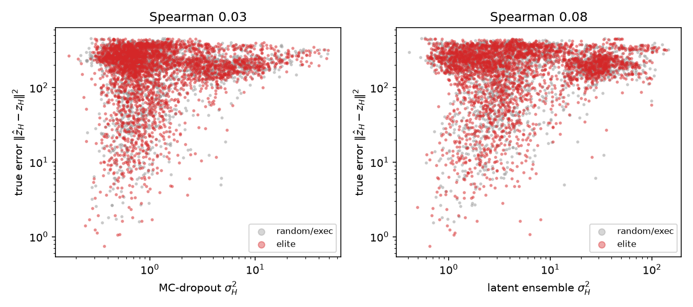
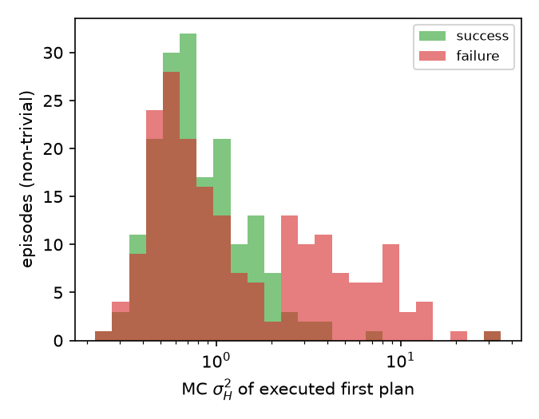
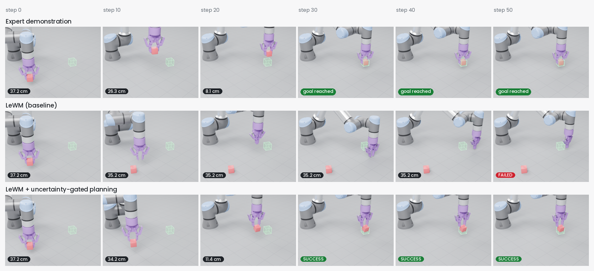
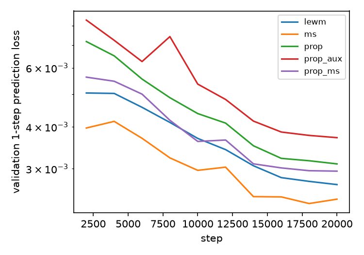

# Does Uncertainty Help a Latent World-Model Planner? A Ground-Truth Study of LeWorldModel on OGBench-Cube

*CS5478 final project. Every number below comes from the result files in
`results/cube/`, which `scripts/cube/make_report.py` collects into
`results/cube/RESULTS.md`.*

## Abstract

LeWorldModel (LeWM) plans by cross-entropy-method (CEM) search for action
sequences whose predicted latent outcome lies closest to a goal image. If plans
fail because the planner exploits model errors, an uncertainty-aware planner
should help. On PushT, however, three such planners gained at most 2.2 points
(p > 0.1).

We test the premise directly on OGBench-Cube pick-and-place. We recorded 807
planning calls of the pretrained LeWM and replayed 41,157 of the candidates it
considered in the simulator, starting from the exact planning state. The
replays are bit-exact. They give every candidate its real outcome and the
model's real prediction error.

**Uncertainty signals.** We compared MC-dropout variance with the disagreement
of a five-member latent dynamics ensemble.
- Both track the size of the prediction error one action block ahead
  (Spearman 0.55 and 0.69).
- Both barely track it at the fifth block, where the planning cost is evaluated
  (0.03 and 0.08).
- Within a planning call, neither separates the elite candidates that fail from
  those that succeed (AUROC 0.49 and 0.52).

**Why selection cannot help.** 83% of failed plans are *search* failures: none
of the replayed alternatives solves the task. Accordingly, re-ranking the
candidates by σ² does not raise success. Neither does a risk head trained on
the replays, although it predicts failure well (test AUROC 0.87).

**Where the search goes wrong.** The model predicts the planner's candidates
far worse than the expert's own actions from the evaluation's start states:
the median five-block error is 207 against 3.9. A rendering check rules out
the simulator's renderer as a cause: with either the hardware or the software
renderer, live frames encode like the dataset's frames.

**Closed loop.** Four planners put σ² into CEM's objective. Two of them raise
success by about 5 points (9 seeds × 50 episodes, paired; both significant
after Holm correction):
- gated horizon truncation: 65.6% → 70.7%, p = 0.0014;
- the ensemble σ² penalty: 65.6% → 70.4%, p = 0.0016.

An MC-dropout σ² penalty and a CVaR penalty gain less, not significantly; MC
averaging alone gains nothing. The ensemble penalty's gain comes from the
search, not from selection. Used only to re-rank the baseline's final
candidates, the same score gains 0.45 points; inside CEM it gains 7.3 on the
non-trivial episodes.

**Representation.** Changes trained under one budget do not help planning.
- A multi-step rollout loss cuts the five-block open-loop error 3.2-fold, yet
  changes success by +1.3 points (n.s.).
- Factorised proprioceptive latents lower success by 3.3–5.6 points (two of
  the three significantly).

## 1 Introduction

**Motivation.** LeWM [Maes et al., 2026] trains two parts jointly from pixels:
- a ViT encoder;
- an action-conditioned transformer predictor.

Training uses a next-latent prediction loss plus the SIGReg anti-collapse
regulariser. LeWM plans with CEM over five action blocks, minimising the
distance between the predicted final latent and the latent of a goal image.

On OGBench-Cube pick-and-place, LeWM reaches 74% success, behind DINO-WM (86%)
and goal-conditioned behaviour cloning (GCBC, 84%). A random policy reaches 48%,
because many evaluation episodes start with the cube already at its goal.

**The hypothesis inherited from the original project.** Plans fail because the
planner exploits model error, so penalising epistemic uncertainty should help
[Chua et al., 2018; Yu et al., 2020; Wu et al., 2022]. A PushT pilot tested this
over 9 seeds × 50 episodes:

| planner | success |
|---|---|
| baseline | 87.3 ± 3.5% |
| MC-5 | 89.6% |
| gated truncation | 88.9% |
| Goal-CVaR | 88.7% |

None of these differences was significant.

**This project.** Small or absent gains are consistent with two explanations
that call for different next steps:
- (a) the uncertainty signal does not identify the model's mistakes;
- (b) it does, but the planners use it poorly.

We separate the two with a ground-truth replay of the planner's decisions (L1).
We then test uncertainty-aware planners (L2), a learned risk model (L3), and
representation changes aimed at the model's errors (L4–L5). The L1 findings
frame how L2–L5 are read.

**Contributions.**
1. **A recorder and simulator oracle** that replay any candidate from its exact
   planning state.
   - The replays are bit-exact, including plans made mid-episode.
   - Mid-episode exactness requires restoring the solver warm start and the
     controller's cached end-effector pose, not only joint positions and
     velocities.
2. **A pre-registered signal test** (Q1–Q6) with plan-clustered bootstrap
   intervals, applied to MC-dropout and to a latent ensemble.
   - Both signals are informative *between* planning problems but not *within*
     a planning call, which is where CEM chooses.
   - Most failures are search failures, not selection failures.
3. **A paired comparison on the 9-seed test panel** of six uncertainty-aware
   planners on Cube, including a risk head learned from the replays.
   - Two planners raise success by about 5 points: gated truncation and an
     ensemble σ² penalty, both of which put σ² into CEM's objective.
   - Re-ranking the baseline's converged candidates does not help.
4. **Five representation variants** of LeWM trained under one budget and
   evaluated three ways: probes, open-loop prediction error and closed-loop
   planning. Better open-loop prediction on dataset sequences does not carry
   over to planning success.
5. **A rendering check.** Live frames from both the hardware and the
   software renderer encode like the dataset's own frames, so the replays
   measure model error, not a rendering artefact.

## 2 Background

**LeWM.**
- The encoder maps a 224×224 frame to z ∈ ℝ¹⁹²: a ViT-tiny/14 CLS token
  followed by an MLP projector with BatchNorm.
- The predictor is a 6-layer causal transformer with AdaLN-zero action
  conditioning. It predicts z_{t+1} from up to 3 past latents and action
  blocks.
- One action block is 5 environment steps × 5 action dimensions, so 25 inputs.
- Training loss: next-latent MSE + 0.09 · SIGReg.

**Planning protocol (paper, Cube).**
- CEM with 300 samples, 30 iterations and the top 30 as elites.
- Horizon of 5 blocks (25 environment steps). The whole plan is executed before
  replanning, so a 50-step episode has at most 2 planning calls (it ends
  when the cube reaches the goal).
- Cost = ‖ẑ₅ − z_goal‖².
- The start and goal come from the expert dataset; the goal is the state 25
  steps after the start.
- Success means the cube is within 4 cm of its goal position.

**Uncertainty in model-based planning.** Epistemic uncertainty can be estimated
by MC-dropout [Gal & Ghahramani, 2016] or deep ensembles
[Lakshminarayanan et al., 2017]. Planners then use it in one of four ways:
- to aggregate rollouts;
- to penalise the objective [Chua et al., 2018; Yu et al., 2020];
- to truncate rollouts [Janner et al., 2019; Wu et al., 2022];
- to plan against a tail risk such as CVaR [Rockafellar & Uryasev, 2000].

## 3 Method

### 3.1 Recording planning calls and replaying them (L1)

`cube/recording.py` subclasses the CEM solver and the MPC policy. Its only side
effect is logging: the recorded costs match the solver's (largest difference
2·10⁻⁴ in the smoke tests, 0 in the L1 recording runs). At every planning call it stores four things.
- **Simulator state.** Joint positions and velocities; the solver warm start;
  the pinch-site pose that the controller caches from the previous step; and
  the goal target (`cube/simstate.py`).
- **Plans.** The executed plan (the final CEM mean) and the final population of
  300 candidates with their costs.
- **Per-candidate scores.** The deterministic cost, and the MC-dropout mean
  cost and spread.
- **Uncertainty profile.** The MC-dropout σ² at each of the 5 predicted blocks
  (8 masks).

A subset of 51 candidates per call is kept for replay: the executed plan, the
30 elites and 20 random non-elites. `cube/oracle.py` restores the stored state
in a fresh simulator and executes each kept candidate open loop, exactly as the
policy would. Actions take the policy's own float32 path through the dataset
action scaler.

The oracle logs the cube-to-goal distance after every step and renders the
frame at the end of every block. The pretrained encoder turns these frames into
the *true* latents z_k, which give two quantities:
- the model's true prediction error, ‖ẑ_k − z_k‖²;
- the cost the planner should have seen, ‖z₅ − z_goal‖².

**Fidelity.** Two checks confirm that the replays are faithful.
- *State check.* Replaying an executed plan must reach the state that the
  evaluation itself recorded 25 steps later (or at the end of the episode).
- *Outcome check.* An episode's real outcome must equal "one of its executed
  plans succeeds in replay".

Restoring only joint positions and velocities is enough for plans made at an
episode start. For mid-episode plans it is not. In our first smoke test, the
fidelity check over five plans found a largest |Δqpos| of 0.14 (median 3·10⁻⁷).
Replays became exact once
the warm start and the cached pose were restored too
(`tests/test_cube_core.py::test_mid_episode_replay_is_exact`).

### 3.2 Uncertainty signals

- **MC-dropout (`mc`).** The pretrained predictor (dropout 0.1) runs with
  dropout active and normalisation statistics frozen, using 8 masks. σ²_k is
  the across-mask variance of ẑ_k, summed over latent dimensions.
- **Latent ensemble (`ens`, `ua/ensemble.py`).**
  - The pretrained encoder is frozen, and the latents of all dataset frames are
    computed once.
  - Five predictor heads with the LeWM architecture are trained, each from a
    different random initialisation on a random 80% of the training episodes.
  - Each head trains for 12,000 steps (batch 512, AdamW, lr 3·10⁻⁴).
  - The loss is the teacher-forced next-latent loss plus a 5-block open-loop
    rollout loss, so the members train on the rollout the planner uses.
  - σ²_ens is the members' disagreement on a candidate. The planner's own
    predictions and costs are unchanged.

### 3.3 Pre-registered questions

A plan is *non-trivial* when the cube is not yet within 4 cm of the goal at
planning time; only these plans enter Q1–Q6.

| | question |
|---|---|
| Q1 | Does the LeWM cost rank candidates by their real outcome (Spearman with final distance; AUROC for failure)? |
| Q2 | Does σ²_k track the true prediction error at each block k? |
| Q3 | Among the elites, does σ²_H separate the candidates that fail (the false-positive question)? Does σ² add to the cost in a cross-validated logistic model? |
| Q4 | Does σ² of the executed first plan predict episode failure, beyond cost and start distance? |
| Q5 | Re-ranking: choose argmin(cost + λσ²_H) among the replayed candidates. λ is selected on 3 calibration seeds and reported on 9 test seeds against λ = 0 (McNemar). |
| Q6 | When an executed plan fails, did a replayed alternative succeed (*selection failure*) or did none (*search failure*)? |

All intervals come from a bootstrap that resamples whole planning calls (or
episodes), never single candidates. Each AUROC is reported twice:
- **pooled** over all candidates;
- **within-plan**: the mean over planning calls with mixed outcomes.

**Verdict rule** (fixed before the analysis):
- **GO** if the Q3 AUROC interval excludes 0.5 and Q5 improves on the test
  seeds;
- **WEAK-SIGNAL** if only Q3 holds;
- **NO-GO** otherwise.

### 3.4 Uncertainty-aware planners on Cube (L2)

| planner | objective | Cube parameters |
|---|---|---|
| baseline | ‖ẑ₅ − z_g‖², one deterministic rollout | – |
| MC-5 | ‖mean of 5 MC-dropout rollouts − z_g‖² | – |
| gated | MC-5; a candidate whose first-block σ²₁ exceeds a threshold is scored at block k* = clamp(round(5 − ω σ²₁), 1, 5) instead of 5 | threshold = median planning-time σ²₁ (0.209), from 16 separate episodes (start seed 1910, disjoint from all panels); ω = 1.21 (ω × threshold as on PushT) |
| Goal-CVaR | MC-5 + elite-calibrated CVaR soft penalty | α = 0.1 |
| σ² penalty (MC) | MC-5 + λ σ²_H | λ = 6.74 |
| σ² penalty (ensemble) | LeWM cost + λ σ²_ens,H | λ = 5.37 (Q5 selection, 3 × median cost / median σ²) |

The MC penalty's λ needs a note: Q5 selected λ = 0 for MC-dropout, so the
pre-specified equal-scale value (median cost / median σ²) was used. This keeps
the comparison non-trivial.

### 3.5 Learned risk head (L3)

**Training data.** The candidates replayed on 16 training seeds: 54,825
candidates from 1,075 planning calls.

**Targets.** Three per candidate: the true terminal prediction error, the true
terminal cost, and segment success.

**Inputs.** Only features the planner already has: z₀, z_goal, the predicted
ẑ₅, the LeWM cost and the MC-dropout σ² profile. A second head without σ²
(`det`) measures whether σ² carries information a learned model can exploit.

**Use in planning.** The planner scores either J = cost + β·ê (`err` mode) or
J = ĉ_true. Head, mode and β were selected on the calibration seeds (142 non-trivial
plans): the `det` head, `err` mode, β = 0.5.

### 3.6 Representation variants (L4)

All variants share four settings:
- warm-started from the pretrained LeWM-Cube;
- trained for 20,000 steps;
- the LeWM recipe: batch 128, AdamW 5·10⁻⁵, bf16, SIGReg 0.09, frameskip 5;
- an episode-level train/validation split.

The `lewm` control is the pretrained model trained further with its original
loss, so each comparison isolates one change.

Factorised models keep the pretrained predictor as their core, behind linear
maps from and to [z_vis ; z_prop]. These maps start at [I | 0] and [I ; 0], so
at step 0 the visual prediction equals the pretrained model's (checked
numerically).

| variant | change |
|---|---|
| `lewm` | control: LeWM retrained under our budget |
| `ms` | + 5-block open-loop rollout loss (the planner's rollout) |
| `prop` | z = [z_vis ; z_prop], z_prop = MLP(proprioception, 19-d); a penalty (weight 0.5) on the share of z_vis variance that is linearly explained by the stop-gradient z_prop |
| `prop_aux` | + training-only cube-pose head on z_vis (position, cos 4θ, sin 4θ: the cube is 90° symmetric), weight 0.1 |
| `prop_ms` | all of the above |

Variants with a proprio block plan with the block-weighted cost
‖Δz_vis‖² + w_prop‖Δz_prop‖², with w_prop ∈ {1, 0.1, 0} selected on the
calibration seeds.

### 3.7 Representation evaluation (L5)

- **Probes.** Linear (ridge) and MLP probes are trained on 24,000 frames of
  held-out episodes and tested on 6,000 more. Targets: cube position, cube yaw
  (cos 4θ, sin 4θ), joint positions and velocities, end-effector position and
  gripper opening. We report Pearson r averaged over target dimensions, as in
  LeWM's Table 4.
- **Open-loop prediction.** We run the planner's rollout (1 context frame,
  k = 1…5 blocks) on held-out dataset sequences and report two errors:
  - the latent error divided by the total latent variance, against a
    "nothing moves" persistence baseline;
  - the cube position decoded from ẑ_k by the linear probe, in centimetres,
    which is comparable across models.
- **Planning.** The 9-seed protocol, with each variant as the cost model.

## 4 Experimental setup

- **Data and checkpoint.** `quentinll/lewm-cube`: the `cube_single_expert`
  dataset (10,000 expert episodes of 201 steps) and the paper's LeWM-Cube
  model.
- **Seeds**, each with 50 episodes; for a given seed, every method sees the
  same start and goal states:

  | role | seeds |
  |---|---|
  | test | 42–45, 1011, 2022, 3033, 4044, 5055 (the PushT panel) |
  | calibration | 910–912 |
  | risk-head training | 100–115 |

- **Statistics.**
  - Paired exact McNemar tests on episodes.
  - Holm correction across the L2/L3 planner family [Holm, 1979].
  - Non-trivial episodes are also reported separately.
- **Compute.** NUS SoC cluster, one GPU per job; commands are in
  `cluster/README.md`.
  - Rendering jobs (planning and replays) ran on A100, H100 or H200 GPUs.
    Some of the A100s were MIG slices, on which MuJoCo renders in software
    (§5.6).
  - Training jobs ran on H100 MIG slices and A100s.
  - Every job is resumable and skips finished runs.

## 5 Results

### 5.1 Protocol check

| quantity | value |
|---|---|
| Baseline success, 9 test seeds × 50 episodes | **65.6 ± 6.0%** (pooled 95% CI 61.1–69.8; per seed 58–80) |
| Reported in the paper | 74% |
| Episodes whose cube starts within 4 cm of the goal (12 recorded runs, 600 episodes) | 36.8% (they succeed 99.5% of the time) |
| Success on non-trivial episodes (same 600 episodes) | 46.2% |
| Replay fidelity | max \|Δqpos\| = **0** over 412 executed plans (207 start-of-episode, 205 mid-episode) |
| Oracle outcome = closed-loop outcome | 600 / 600 episodes |

Our baseline is below the published 74%, which lies outside our interval.
- We use the released checkpoint and the released evaluation configuration.
- Per-seed variation is large: 50-episode runs range from 58% to 80%.
- Rendering is not the cause (§5.6); the gap is otherwise unexplained.
- All comparisons below are paired within our own panel.

### 5.2 Is σ² a useful risk signal? (L1)

The analysis covers 12 recorded baseline runs (3 calibration + 9 test seeds;
600 episodes), 807 planning calls and 41,157 replayed candidates. Of these, 586
planning calls are non-trivial.

**Q1. The cost ranks problems, not candidates.**
- Over all candidates, the LeWM cost correlates with the final cube distance
  (Spearman 0.39, CI 0.34–0.44) and predicts failure (AUROC 0.64, CI
  0.61–0.67).
- Within a planning call the correlation vanishes (mean Spearman 0.03; AUROC
  0.56 on the 180 calls with mixed outcomes).

So the cost mostly tells hard start states from easy ones.

**Q2. σ² tracks the error at short horizon only.** Spearman between σ²_k and
‖ẑ_k − z_k‖², pooled with plan-bootstrap 95% CI; within-plan means in brackets:

| block k | MC-dropout | latent ensemble |
|---|---|---|
| 1 | 0.555 [0.508, 0.605] (0.28) | 0.686 [0.645, 0.722] (0.42) |
| 2 | 0.452 [0.394, 0.502] (0.17) | 0.592 [0.548, 0.638] (0.27) |
| 3 | 0.358 [0.297, 0.412] (0.10) | 0.517 [0.467, 0.563] (0.16) |
| 4 | 0.258 [0.189, 0.315] (0.06) | 0.400 [0.323, 0.453] (0.08) |
| 5 = H | 0.032 [−0.029, 0.092] (0.04) | 0.084 [0.007, 0.151] (0.06) |
| σ²_H vs \|cost − true cost\| | 0.040 [−0.023, 0.103] | 0.092 [0.012, 0.157] |

The ensemble is the better signal at every block. At the final block, where
the cost is evaluated, both correlations are close to zero (Figure 1). The same
holds for the error of the cost itself.

The size of the error matters as much as its ranking.
- On the planner's candidates, the median error at block 5 is 207 for the
  pretrained predictor and 206 for the ensemble mean.
- On the expert's own actions from the evaluation's start states, it is 3.9
  (median; §5.6).
- On held-out dataset sequences, the mean error is 0.044 of the total latent
  variance (§5.5).

So the model predicts the planner's candidates far worse than the expert's
motions. The medians differ by a factor of about 50. The two sets of states
overlap but are not the same: the candidates come from non-trivial planning
calls, including second plans; the expert check uses all start states of two
seeds.

*Figure 1. Terminal σ² vs the true terminal prediction error for replayed
candidates (red: elites). Left: MC-dropout; right: latent ensemble.*

**Q3. Within a call, σ² does not flag the failing elites.** 71.4% of the
elites of non-trivial plans fail; 158 calls have elites of both outcomes.

| score | pooled AUROC (failure) [95% CI] | within-plan AUROC |
|---|---:|---:|
| LeWM cost | 0.624 [0.588, 0.661] | 0.535 |
| MC σ²_H | 0.628 [0.592, 0.662] | 0.492 |
| ensemble σ²_H | 0.618 [0.584, 0.657] | 0.524 |
| MC σ²₁ | 0.453 [0.415, 0.494] | 0.523 |
| MC cost spread | 0.634 [0.600, 0.668] | 0.518 |

Adding σ²_H to the cost in a cross-validated logistic failure model changes the
AUROC by +0.003 for MC-dropout (CI −0.004 to 0.012) and by −0.002 for the
ensemble (CI −0.014 to 0.011).

**Q4. At the episode level, σ² flags a group of hopeless problems.** Over 379
non-trivial episodes (53.8% fail), the MC σ²_H of the executed first plan
predicts failure about as well as the start distance:

| predictor | AUROC | 95% CI |
|---|---:|---|
| MC σ²_H | 0.60 | 0.55–0.66 |
| start distance | 0.61 | 0.56–0.67 |
| LeWM cost | 0.57 | – |

Its distribution has a high-σ² mode (σ²_H ≳ 2.5) made up almost only of
failures (Figure 2). On top of cost and start distance:
- MC-dropout adds nothing (cross-validated AUROC 0.553 → 0.548);
- the ensemble adds a little (0.553 → 0.593).

*Figure 2. MC-dropout σ²_H of the executed first plan, for non-trivial episodes
that succeed or fail.*

**Q5. Re-ranking does not help.**
- *MC-dropout.* The calibration seeds select λ = 0.
- *Ensemble.* They select λ* = 5.37. On the 444 non-trivial test plans this
  moves success of the re-ranked choice from 29.3% to 29.7% (14 plans gained,
  12 lost; p = 0.85).
- *Upper bound.* For comparison, the executed plans succeed 30.0% of the time,
  and an oracle that picks the best replayed candidate would reach 41.2%.

**Q6. Most failures are search failures.**

| plans (non-trivial) | n | executed plan succeeds | selection failures | search failures | cost gap, failed | cost gap, succeeded |
|---|---:|---:|---:|---:|---:|---:|
| all | 586 | 29.9% | 16.8% | **83.2%** | 252 | 45.5 |
| first plan | 379 | 45.6% | 29.1% | 70.9% | 236 | 45.5 |
| second plan | 207 | 1.0% | 4.4% | 95.6% | 266 | 81.2 |

- A failure is a *selection failure* if another replayed candidate (of 51)
  succeeds.
- The *cost gap* is the true minus the predicted cost of the executed plan
  (median).
- Second plans start after a failed first plan and almost never recover.
- For executed plans that fail, the model is far more optimistic than for
  those that succeed.

**Verdicts** (by the pre-registered rule):
- **MC-dropout: WEAK-SIGNAL.** The Q3 interval excludes 0.5; Q5 does not
  improve.
- **Latent ensemble: GO.** The Q3 interval excludes 0.5, and the Q5 test
  success improves, but by only 0.45 points (2 of 444 plans; not
  significant).

The rule used the pooled Q3 AUROC. The within-plan AUROC, which is what
re-ranking depends on, is ≈ 0.5 for both signals (§6.1).

**The ensemble itself.** On held-out episodes, the ensemble mean predicts
better than the pretrained predictor at every block. Its squared error over
blocks 1–5 is 0.95, 2.10, 3.67, 5.55, 7.17, against 1.05, 2.39, 4.31, 6.51,
8.31 for the pretrained predictor; single members are close to the pretrained
predictor. On these in-distribution sequences, σ²_ens tracks the
ensemble-mean error with Spearman 0.35–0.46 per block. Training took 95
minutes for all five members.

### 5.3 Uncertainty-aware planners in closed loop (L2, L3)

Paired against the baseline on the same start and goal states (9 seeds × 50
episodes each):

| planner | success (%) | Δ (pp) | gained / lost | McNemar p | Holm-adjusted p | Δ non-trivial (pp) |
|---|---:|---:|---:|---:|---:|---:|
| baseline | 65.6 ± 6.0 | – | – | – | – | – |
| MC-5 | 65.8 ± 5.2 | +0.2 | 21 / 20 | 1.00 | 1.00 | +0.0 |
| **gated** | **70.7 ± 4.8** | **+5.1** | **36 / 13** | **0.0014** | **0.008** | **+7.7** |
| Goal-CVaR | 66.9 ± 5.7 | +1.3 | 26 / 20 | 0.46 | 1.00 | +1.7 |
| σ² penalty (MC) | 68.0 ± 6.2 | +2.4 | 25 / 14 | 0.11 | 0.43 | +3.8 |
| **σ² penalty (ensemble)** | **70.4 ± 6.1** | **+4.9** | **34 / 12** | **0.0016** | **0.008** | **+7.3** |
| risk head (L3) | 66.2 ± 7.1 | +0.7 | 30 / 27 | 0.79 | 1.00 | +0.7 |

- **Two planners help, by about 5 points each**, and both remain significant
  after Holm correction over the six planners:
  - gated truncation raises success in 6 of 9 seeds (+4 to +14 points) and
    lowers it in 3 (−2 to −4);
  - the ensemble σ² penalty raises it in 8 of 9 seeds (+2 to +12) and lowers
    it in one (−2).
  - On the non-trivial episodes, both gain 7–8 points (p = 0.002 each).
- **The others do not.** MC averaging alone, the CVaR penalty and the
  MC-dropout σ² penalty change success by 0.2–2.4 points, none significantly.
  The risk head gains 0.7 points.
- **What the gate does.** It truncates rarely: the mean scored horizon is 4.86
  blocks (4.73–4.94 per seed), so most candidates are still scored at block 5.
- **The penalties do steer the plans.** The MC σ² penalty lowers the mean σ² of
  the candidates it scores from 0.93 (MC-5) to 0.74.
- **Noise floor.** Re-running the *same* planner on the same seeds (the
  visualisation runs, wherever Slurm placed them) changed 20 of 300 episode
  outcomes. MC-5
  against the baseline flips 41 of 450 episodes, in both directions, for no
  net gain. A single 50-episode run therefore says little; the panel pairs 450
  episodes per planner.

*Figure 4. One test episode (seed 42) replayed from the logged actions and
rendered with Blender. The episode was selected because the two planners
disagree; it is an illustration, not evidence. The baseline lets go of the cube
at the start and moves the empty gripper to the goal. The gated planner carries
the cube there and succeeds at step 24. The green box marks the goal; the
labels give the cube–goal distance. Over all 450 test episodes, success is
65.6% for the baseline and 70.7% for gated planning. More examples and videos:
`results/cube/viz/`.*

### 5.4 The learned risk head (L3, offline)

| head | Spearman with true error (calibration / test) | AUROC failure (calibration / test) |
|---|---:|---:|
| with σ² (`full`) | 0.553 / 0.505 | 0.879 / 0.891 |
| without σ² (`det`) | 0.558 / 0.449 | 0.883 / 0.873 |
| LeWM cost | – | 0.637 / 0.643 |

- **Prediction.** The head predicts failure far better than the LeWM cost.
  Without σ² it is as good on the calibration seeds and slightly worse on the
  test seeds. So σ² adds a little to what a learned model extracts from the
  latents and the cost.
- **Re-ranking.** It still does not help. On the calibration seeds every head,
  mode and β gives between 26.8% and 29.6%, against 28.9% for the LeWM cost
  alone. On 444 test
  plans the risk-aware choice succeeds 29.3% of the time, exactly like the
  LeWM-cost choice (13 plans gained, 13 lost).
- **Closed loop.** The risk planner gains 0.7 points (p = 0.79; §5.3).

### 5.5 Representations (L4, L5)

**Training.** All five variants trained for 20,000 steps from the pretrained
model, taking 53–111 minutes each on one GPU (Figure 3). The factorised models
end with a higher one-step validation loss than the control. Their loss also
covers the proprio block, so it is not directly comparable; §5.5 below
compares the variants by open-loop error relative to each model's latent
variance and by the decoded cube position.

*Figure 3. Validation one-step prediction loss during L4 training (log scale).*

**Probes** (Pearson r, linear / MLP, held-out episodes):

| checkpoint | dim | cube position | cube yaw (4θ) | joint velocity | effector position | gripper |
|---|---:|---:|---:|---:|---:|---:|
| pretrained LeWM | 192 | 0.996 / 0.999 | 0.19 / 0.36 | 0.04 / 0.08 | 0.989 / 0.999 | 0.96 / 0.99 |
| `lewm` (control) | 192 | 0.995 / 0.999 | 0.23 / 0.36 | 0.04 / 0.07 | 0.988 / 0.999 | 0.96 / 0.99 |
| `ms` | 192 | 0.997 / 0.999 | 0.02 / 0.21 | 0.05 / 0.08 | 0.992 / 0.999 | 0.96 / 0.99 |
| `prop` | 224 | 0.972 / 0.999 | 0.22 / 0.36 | 0.44 / 0.89 | 0.985 / 0.999 | 0.97 / 1.00 |
| `prop_aux` | 224 | 0.973 / 0.999 | **0.97 / 0.95** | 0.44 / 0.89 | 0.985 / 0.999 | 0.97 / 1.00 |
| `prop_ms` | 224 | 0.983 / 0.999 | 0.47 / 0.51 | 0.38 / 0.83 | 0.990 / 0.999 | 0.97 / 1.00 |

What the latents encode:
- **Pretrained LeWM.** Its latent encodes cube position, effector position and
  gripper opening linearly, but hardly the cube's yaw or the arm's velocity.
  Joint positions reach linear r ≈ 0.66–0.70 for every model, but R² ≤ 0.15
  (mostly ≤ 0), so they are not decodable in a useful sense.
- **The proprio block** makes joint velocity decodable, non-linearly (MLP
  r 0.83–0.89).
- **The cube-pose head** makes yaw linearly decodable (0.97).
- **The visual block alone (z_vis).** Probed by itself, it loses the linear
  cube position in the factorised models:
  - linear r = 0.29 (`prop`), 0.47 (`prop_aux`) and 0.74 (`prop_ms`);
  - the MLP still reaches 0.999 in all three;
  - effector position drops in the same way (linear 0.27 / 0.41 / 0.70).

**Open-loop prediction** on held-out dataset sequences:

| checkpoint | rel. latent error k = 1 | k = 5 | persistence k = 5 | cube error from ẑ₅ [cm] (from true z₅) |
|---|---:|---:|---:|---:|
| pretrained LeWM | 0.005 | 0.044 | 1.335 | 1.57 (1.42) |
| `lewm` (control) | 0.003 | 0.034 | 1.317 | 1.51 (1.50) |
| `ms` | 0.002 | **0.010** | 1.301 | **1.19** (1.13) |
| `prop` | 0.004 | 0.036 | 1.365 | 2.36 (3.39) |
| `prop_aux` | 0.004 | 0.034 | 1.340 | 2.28 (3.37) |
| `prop_ms` | 0.003 | 0.011 | 1.306 | 1.97 (2.74) |

- **The multi-step loss** cuts the 5-block latent error 3.2-fold against the
  control (4.2-fold against the pretrained model). It also lowers the decoded
  cube-position error.
- **Factorised models** have larger cube errors even from the true latent.
  A linear probe recovers the cube position less precisely from their latent
  (r 0.97–0.98, against 0.996).

**Planning** (9 test seeds; w_prop selected on calibration seeds):

| checkpoint | w_prop | success (%) | Δ vs pretrained (p) | Δ vs `lewm` control (p) |
|---|---:|---:|---:|---:|
| pretrained LeWM | – | 65.6 ± 6.0 | – | −1.1 (0.61) |
| `lewm` (control) | – | 66.7 ± 7.3 | +1.1 (0.61) | – |
| `ms` | – | 68.0 ± 5.8 | +2.4 (0.17) | +1.3 (0.54) |
| `prop` | 0 | 61.6 ± 7.9 | **−4.0 (0.027)** | **−5.1 (0.007)** |
| `prop_aux` | 1 | 63.3 ± 8.1 | −2.2 (0.22) | −3.3 (0.058) |
| `prop_ms` | 0.1 | 61.1 ± 7.6 | **−4.4 (0.024)** | **−5.6 (0.004)** |

- **w_prop selection.** Over the three calibration seeds, the w_prop values
  differ by at most 2.7 points for every variant.
- **Results.**
  - Retraining alone changes nothing.
  - The multi-step loss gives a small, non-significant gain.
  - All three proprio-factorised variants plan worse than the control, by
    3.3–5.6 points (p = 0.007, 0.058 and 0.004). The non-trivial episodes lose
    5.6–8.7 points.

### 5.6 Check: live-rendered vs dataset frames

The evaluation gives the first plan dataset frames, for both the start and the
goal; every later observation is rendered live, and so are the replays. If the
encoder saw live frames differently from dataset frames, the errors in §5.2
would contain a rendering gap, and second plans would be handicapped.

`scripts/cube/check_domain_gap.py` tests this on the 100 evaluation start
states of seeds 42 and 43. It renders each dataset state live, replays the
dataset's own next 25 actions, and encodes both kinds of frame.

We ran it with both renderers our planning jobs used, depending on where
Slurm placed them:
- software rendering on a MIG slice of an A100 (about 240 ms per frame);
- hardware rendering on a whole H100 (4 ms per frame).

Medians, with 10th–90th percentiles:

| quantity | software renderer | hardware renderer |
|---|---|---|
| pixel difference, live vs dataset frame of the same state (0–255) | 0.36 [0.22, 0.54] | 0.24 [0.08, 0.43] |
| latent distance, live vs dataset frame of the same state | **0.02** [0.01, 0.06] | **0.01** [0.00, 0.02] |
| cube drift when the dataset's actions are replayed | 0.01 cm | 0.01 cm |
| 5-block prediction error of the expert's actions, from the dataset start frame | 3.87 [1.37, 20.7] | 3.87 [1.37, 20.7] |
| the same, from the live start frame, against live frames | 3.82 [1.41, 24.3] | 3.74 [1.41, 20.7] |

For scale, dataset frames 5 steps apart lie 32.8 apart, and random pairs of
frames 388.

- **No rendering gap with either renderer.** Live frames encode like the
  dataset's frames, at a distance about 1,600 times smaller than one block of
  motion (software) or smaller still (hardware).
- **The simulator reproduces the dataset**, and the model predicts expert
  motion equally well from either kind of frame.
- **What this means for §5.2.** The replays measure model error, and the gap
  between the planner's candidates (207) and the expert's actions (3.9) is not
  a rendering artefact. Rendering explains neither the weak second plans nor
  the gap to the published baseline.

## 6 Discussion

### 6.1 Is the signal uninformative, or is it used poorly?

Both readings of the PushT result hold, for different uses of σ².

**As a selector among the baseline's converged candidates, σ² is
uninformative.** The elites of a planning call usually share their fate: only
158 of 586 non-trivial calls have elites with both outcomes. Within a call,
neither signal separates the elites that fail (AUROC 0.49 and 0.52), and
neither does the LeWM cost (0.53). The learned risk head detects failure far
better (test AUROC 0.87–0.89), yet it cannot choose a better plan either.

The pooled AUROCs of 0.62–0.63 look like a usable signal. They mostly say that
hard start states have higher σ² and fail more often. In hindsight, our
pre-registered verdict rule should have used the within-plan AUROC.

**Inside CEM's objective, σ² can help.** Two of the four planners that use it
there gain about 5 points (§6.3). Offline re-ranking (Q5) underestimates this
by far. On the non-trivial plans, re-ranking with the ensemble penalty gained
0.45 points; the same penalty inside CEM gained 7.3 points on the non-trivial
episodes.

### 6.2 Search failures dominate, and the search explores where the model is unreliable

**Selection is not the main problem.** Only 17% of failed plans had a
successful alternative among the replayed candidates, and only 4% of failed
second plans. Even a perfect selector over the replayed candidates would raise
non-trivial plan success only from 30% to 41%.

**The model expected its failed plans to work.** For failed executed plans,
the true cost exceeds the predicted cost by a median of 252, against 45.5 for
successes. This is what the optimizer's curse [Smith & Winkler, 2006] leads
one to expect. CEM picks the lowest predicted costs, and these tend to be the
most underestimated. Our data, however, do not compare selected with
unselected candidates.

**The candidates lie where the model is least accurate.** The model predicts
the expert's 25 actions from the evaluation's start states with a median
5-block error of 3.9. On the planner's candidates the median is 207. The two
sets of states overlap but differ: the candidates include mid-episode second
plans, the expert check includes trivial start states. Still, a difference
this large points to the action sequences. A likely reason is the sampling:
CEM draws each action independently from a Gaussian in the normalised action
space, so its candidates need not resemble the smooth expert motions the model
was trained on.

### 6.3 How uncertainty helps: through the search

The plan CEM returns is the mean of its final elites, and every L2 planner
changes the score that picks those elites in each of the 30 iterations. So
each one acts on the search as well as on the final choice.

**The ensemble penalty.** For this planner the two effects can be compared
directly. The same score, applied only to the baseline's final candidates
(Q5), changed plan success by 0.45 points. Applied inside CEM, it changed
episode success on the non-trivial episodes by 7.3 points. Its benefit
therefore comes from the different candidates the modified search produces.

**The gate.** We could not test its score offline: the records hold no
intermediate-block costs. The gate scores a candidate whose first-block
MC-dropout σ² is high at an earlier block. This penalises uncertain candidates
that reach the goal late, and favours those predicted to arrive early, which
leaves margin for error later in the plan.

**Which planners help fits the strength of each signal.**
- **The ensemble's σ² is the stronger signal** in every comparison we ran. It
  is better in Q2 at every block, and it is the only one that adds to cost and
  start distance in Q4. At block 5, though, even it tracks the error only
  weakly (0.08).
- **The gate reads MC-dropout's σ² at block 1**, where that signal is
  strongest (0.55).
- **The MC σ²_H penalty** uses MC-dropout's weakest signal (0.03 at block 5)
  and gains +2.4 points, not significantly.
- **The CVaR penalty is tiny on Cube.** It is 1.1% of the cost, and 98% of the
  elites are the same as without it.
- **MC averaging alone does not favour confident candidates at all.**

We did not record these planners' searches. Two things therefore remain open:
whether the candidates they favour are actually predicted more accurately, and
how much of the gate's gain comes from each of its two effects. A recorded run
of each, with replays, would answer both.

### 6.4 Better prediction is not better planning

**Multi-step training does what it targets but barely moves planning.** The
5-step loss improves the planner's own rollout on dataset sequences 3.2-fold
and lowers the decoded cube error, yet success rises by only 1.3 points over
the control. This is consistent with §6.2: the error that matters is on the
planner's candidates, where it is far larger than on expert motion, and a loss
on dataset sequences need not reduce it.

**The proprio factorisation hurts, and we can only partly say why.** All three
factorised variants plan worse than the control (−3.3 to −5.6 points; two of
the three significantly). One contributor is plausible:
- The de-redundancy penalty pushes z_vis to drop variance that the arm state
  explains linearly.
- In pick-and-place data the cube moves with the gripper, so the penalty also
  removes linear cube-position directions from z_vis: linear r drops from
  0.996 to 0.29, while the MLP r stays at 0.999.

This does not explain everything. `prop_ms` restores the most linear cube
information (0.74) and still plans worst. `prop_aux` plans with w_prop = 1,
where the full latent decodes the cube position linearly (0.97). The changed
predictor interface and the proprio block in the cost may matter as well.

**What the representation lacks matters less than how it is searched.** The
proposal's motivation was that LeWM's latent "misses rotation and motion",
and the probes confirm this (yaw 0.19, joint velocity 0.04). Adding that
information did not help planning, at least not in the form we added it.

### 6.5 What would help

The evidence points to the search distribution and to the data the model sees.
- **Keep the search near the data.**
  - Use σ² inside the search, as the two successful planners do. The ensemble
    signal is the better one.
  - Start CEM from a goal-conditioned BC prior [Argenson & Dulac-Arnold, 2021;
    Hansen et al., 2022]; GCBC alone reaches 84% on Cube.
  - Sample temporally correlated noise [Pinneri et al., 2020].

  These address both the search failures and the off-distribution error. The
  BC prior was the third lever of our proposal, and we did not reach it.
- **Train on the planner's own candidates.** The 41k replays are exactly such
  data, with true latents and outcomes, in the spirit of DAgger
  [Ross et al., 2011].
- **Use σ² for what it can do on its own.** It flags problems the planner will
  not solve (Figure 2), which suits abstention, hand-off or more frequent
  replanning.

## 7 Limitations

- **One environment, one checkpoint.** L4 variants were warm-started and
  trained for 20,000 steps, which may be below what some changes need.
- **The replays cover 51 of the 300 final candidates per call.** "Search
  failure" means that none of these succeeds. The oracle upper bound is
  therefore a lower bound on what a full re-ranking could reach.
- **Mechanisms not measured.** We did not record the searches of the two
  successful planners (§6.3), and the account of the proprio variants is
  partial (§6.4).
- **Multiple comparisons.** p-values are exact McNemar values. The planner
  family is also Holm-adjusted; the representation comparisons are not.
- **Run-to-run variation.** Re-running a seed changed up to 8 of 50 outcomes,
  so single-seed differences are not meaningful. Our conclusions rest on the
  paired 450-episode panels.
- **Baseline gap.** Our baseline is below the published number. Rendering is
  not the cause (§5.6); we have not identified what is.

## 8 Conclusion

On OGBench-Cube, uncertainty does not help LeWM's planner choose among the
plans its search converges to. It can help when it is part of the search
objective.
- **Selection.** MC-dropout and ensemble variance track the model's
  short-horizon errors and identify hard problems. They do not identify the
  failing plans within a problem, and 83% of failed plans had no successful
  alternative to select.
- **Search.** The search proposes action sequences the model predicts far
  worse than the expert's, and the model expected its failed plans to work.
  Two planners that put σ² into CEM's objective raise success by about 5
  points: gated truncation and the ensemble σ² penalty, both p < 0.01 after
  correction. For the ensemble penalty, the gain demonstrably comes from the
  search.
- **Representation.** Changes that improve open-loop prediction on dataset
  sequences do not improve planning, and factorising out proprioception hurts
  it.

The next lever is the search distribution itself: keeping candidates near the
data, with uncertainty, a behaviour-cloning prior or correlated sampling, and
training the model on the candidates the planner actually proposes.

## References

- L. Maes, Q. Le Lidec, D. Scieur, Y. LeCun, R. Balestriero. *LeWorldModel*. arXiv:2603.19312, 2026.
- G. Zhou, H. Pan, Y. LeCun, L. Pinto. *DINO-WM: World Models on Pre-trained Visual Features enable Zero-shot Planning*. ICML 2025.
- S. Park, K. Frans, B. Eysenbach, S. Levine. *OGBench: Benchmarking Offline Goal-Conditioned RL*. ICLR 2025.
- K. Chua, R. Calandra, R. McAllister, S. Levine. *Deep Reinforcement Learning in a Handful of Trials using Probabilistic Dynamics Models*. NeurIPS 2018.
- T. Yu, G. Thomas, L. Yu, S. Ermon, J. Zou, S. Levine, C. Finn, T. Ma. *MOPO: Model-based Offline Policy Optimization*. NeurIPS 2020.
- Y. Gal, Z. Ghahramani. *Dropout as a Bayesian Approximation: Representing Model Uncertainty in Deep Learning*. ICML 2016.
- B. Lakshminarayanan, A. Pritzel, C. Blundell. *Simple and Scalable Predictive Uncertainty Estimation using Deep Ensembles*. NeurIPS 2017.
- J. Wu, Z. Huang, C. Lv. *Uncertainty-Aware Model-Based Reinforcement Learning: Methodology and Application in Autonomous Driving*. IEEE T-IV, 2022.
- M. Janner, J. Fu, M. Zhang, S. Levine. *When to Trust Your Model: Model-Based Policy Optimization*. NeurIPS 2019.
- R. T. Rockafellar, S. Uryasev. *Optimization of Conditional Value-at-Risk*. Journal of Risk, 2000.
- R. Balestriero, Y. LeCun. *LeJEPA: Provable and Scalable Self-Supervised Learning Without the Heuristics*. 2025.
- J. E. Smith, R. L. Winkler. *The Optimizer's Curse: Skepticism and Postdecision Surprise in Decision Analysis*. Management Science, 2006.
- S. Holm. *A Simple Sequentially Rejective Multiple Test Procedure*. Scandinavian Journal of Statistics, 1979.
- C. Pinneri, S. Sawant, S. Blaes, J. Achterhold, J. Stueckler, M. Rolinek, G. Martius. *Sample-efficient Cross-Entropy Method for Real-time Planning*. CoRL 2020.
- A. Argenson, G. Dulac-Arnold. *Model-Based Offline Planning*. ICLR 2021.
- N. Hansen, X. Wang, H. Su. *Temporal Difference Learning for Model Predictive Control*. ICML 2022.
- S. Ross, G. Gordon, D. Bagnell. *A Reduction of Imitation Learning and Structured Prediction to No-Regret Online Learning*. AISTATS 2011.
