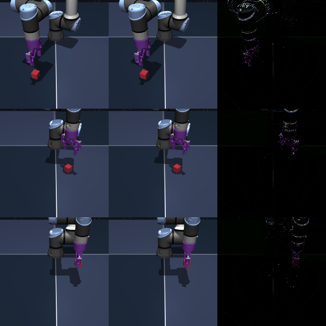
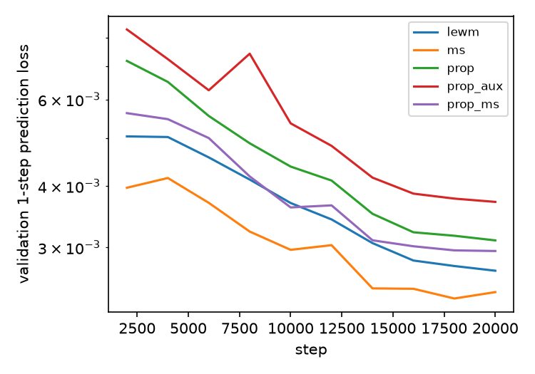

# OGBench-Cube results (auto-generated)

Produced by `scripts/cube/make_report.py`; every number comes from the files it links. Test panel = seeds 42, 43, 44, 45, 1011, 2022, 3033, 4044, 5055 (50 episodes each).

## Dataset and protocol

- 10000 episodes, 2010000 frames (cube_single_expert.h5), episode length {'min': 201, 'median': 201.0, 'max': 201}
- start states already within 4 cm of the goal (any action succeeds): 36.2% on average over the protocol seeds

## L1 sigma^2 signal test

Details: [l1/signal_report.md](l1/signal_report.md)

- MC-dropout: verdict **WEAK-SIGNAL**; elite-failure AUROC 0.628 (95% CI [0.592, 0.662])
- latent ensemble: verdict **GO**; elite-failure AUROC 0.618 (95% CI [0.584, 0.657])

### Live rendering vs dataset frames (diagnostic)

Generated by `scripts/cube/check_domain_gap.py`: 100 evaluation start states (seeds 42, 43), encoder `cube/lewm`. Squared latent distances, median [10th, 90th percentile].

- pixels, live vs dataset frame of the same state: mean abs. difference 0.36 [0.22, 0.54] (0-255 scale); share of pixels differing by more than 8: 0.01 [0.00, 0.02]
- **render gap** (latent, same state): 0.02 [0.01, 0.06]
- references: dataset frames 5 steps apart 32.84 [7.39, 123.98], 25 steps apart 279.87 [96.38, 387.25], random pairs 388.36 [337.31, 430.77]
- action alignment that reproduces the dataset: {'action[r]': 95, 'action[r+1]': 5}

| block k | segment gap (live vs dataset) | replay drift of the cube [cm] | pred. error: dataset start → dataset frames | dataset start → live frames | live start → live frames |
|---:|---|---|---|---|---|
| 1 | 0.02 [0.01, 0.05] | 0.01 [0.00, 0.03] | 0.68 [0.40, 1.75] | 0.68 [0.40, 1.81] | 0.69 [0.40, 1.80] |
| 2 | 0.02 [0.01, 0.05] | 0.01 [0.00, 0.03] | 1.33 [0.63, 5.13] | 1.25 [0.66, 5.06] | 1.25 [0.61, 4.82] |
| 3 | 0.02 [0.01, 0.05] | 0.01 [0.00, 0.03] | 2.32 [0.81, 7.83] | 2.25 [0.78, 8.99] | 2.06 [0.81, 8.89] |
| 4 | 0.02 [0.01, 0.06] | 0.01 [0.00, 0.03] | 2.61 [1.10, 13.48] | 2.68 [1.08, 14.01] | 2.65 [1.14, 13.94] |
| 5 | 0.02 [0.01, 0.07] | 0.01 [0.00, 0.03] | 3.87 [1.37, 20.68] | 3.85 [1.40, 21.66] | 3.82 [1.41, 24.26] |

Planning cost of the expert's own 25 actions against the goal frame: from the dataset start frame 3.87 [1.37, 20.68], from the live start frame 3.70 [1.44, 19.37].

### Latent dynamics ensemble (second uncertainty signal)

Open-loop squared latent error on held-out episodes, blocks k = 1..5:

| model | k=1 | k=2 | k=3 | k=4 | k=5 |
|---|---:|---:|---:|---:|---:|
| pretrained | 1.05 | 2.39 | 4.31 | 6.51 | 8.31 |
| ensemble_mean | 0.95 | 2.10 | 3.67 | 5.55 | 7.17 |
| member_0 | 1.24 | 2.53 | 4.23 | 6.27 | 8.08 |
| member_1 | 1.22 | 2.47 | 4.16 | 6.21 | 7.99 |
| member_2 | 1.21 | 2.48 | 4.19 | 6.23 | 8.01 |
| member_3 | 1.22 | 2.47 | 4.13 | 6.12 | 7.88 |
| member_4 | 1.23 | 2.51 | 4.18 | 6.17 | 7.91 |

Spearman(sigma^2_ens, ensemble-mean error) per block: 0.352, 0.370, 0.418, 0.454, 0.459

## L2 / L3 planners

Generated by `scripts/cube/summarize_runs.py`. Success rates in %, 50 episodes per seed.

| label | 42 | 43 | 44 | 45 | 1011 | 2022 | 3033 | 4044 | 5055 | mean ± std | pooled [95% CI] | non-trivial |
|---|---:|---:|---:|---:|---:|---:|---:|---:|---:|---:|---:|---:|
| baseline | 64 | 80 | 64 | 64 | 66 | 62 | 58 | 66 | 66 | **65.6 ± 6.0** | 65.6 [61.1, 69.8] | 46.3 (n=287) |
| mc5 | 66 | 78 | 60 | 66 | 62 | 62 | 68 | 66 | 64 | **65.8 ± 5.2** | 65.8 [61.3, 70.0] | 46.3 (n=287) |
| gated | 74 | 76 | 62 | 70 | 64 | 74 | 72 | 70 | 74 | **70.7 ± 4.8** | 70.7 [66.3, 74.7] | 54.0 (n=287) |
| goal_cvar | 72 | 78 | 60 | 66 | 68 | 60 | 64 | 66 | 68 | **66.9 ± 5.7** | 66.9 [62.4, 71.1] | 48.1 (n=287) |
| penalty | 74 | 82 | 64 | 68 | 66 | 62 | 66 | 64 | 66 | **68.0 ± 6.2** | 68.0 [63.6, 72.1] | 50.2 (n=287) |
| ens_penalty | 70 | 84 | 62 | 66 | 68 | 70 | 70 | 74 | 70 | **70.4 ± 6.1** | 70.4 [66.1, 74.5] | 53.7 (n=287) |
| risk | 72 | 80 | 56 | 62 | 68 | 62 | 64 | 70 | 62 | **66.2 ± 7.1** | 66.2 [61.7, 70.4] | 47.0 (n=287) |

### Paired comparison against `baseline` (same start/goal states)

| label | seeds | Δ mean (pp) | gained / lost episodes | McNemar p | Δ non-trivial (pp) | p (non-trivial) |
|---|---:|---:|---:|---:|---:|---:|
| mc5 | 9 | +0.22 | 21 / 20 | 1 | +0.00 | 1 |
| gated | 9 | +5.11 | 36 / 13 | 0.0014 | +7.67 | 0.00209 |
| goal_cvar | 9 | +1.33 | 26 / 20 | 0.461 | +1.74 | 0.551 |
| penalty | 9 | +2.44 | 25 / 14 | 0.108 | +3.83 | 0.108 |
| ens_penalty | 9 | +4.89 | 34 / 12 | 0.00164 | +7.32 | 0.00246 |
| risk | 9 | +0.67 | 30 / 27 | 0.791 | +0.70 | 0.894 |

Offline risk-head report: [l3/risk_report.md](l3/risk_report.md)

## L4 representation training

| variant | steps | finished | train pred | val pred (1-step) | val 5-step | val redundancy R² | val aux | samples/s |
|---|---:|:---:|---:|---:|---:|---:|---:|---:|
| lewm | 20000 | yes | 0.0057 | 0.0027 |  |  |  | 1018 |
| ms | 20000 | yes | 0.0041 | 0.0024 | 0.0061 |  |  | 497 |
| prop | 20000 | yes | 0.0071 | 0.0031 |  | 0.4081 |  | 552 |
| prop_aux | 20000 | yes | 0.0073 | 0.0037 |  | 0.4065 | 0.0094 | 822 |
| prop_ms | 20000 | yes | 0.0050 | 0.0030 | 0.0068 | 0.3822 | 0.1062 | 412 |

## L5 representations

Generated by `scripts/cube/eval_representation.py`.

### Probes: Pearson r (linear / MLP), latent z

| checkpoint | dim | cube_pos | cube_yaw4 | joint_pos | joint_vel | effector_pos | gripper |
|---|---:|---:|---:|---:|---:|---:|---:|
| cube/lewm | 192 | 0.996 / 0.999 | 0.187 / 0.362 | 0.661 / 0.683 | 0.044 / 0.081 | 0.989 / 0.999 | 0.959 / 0.988 |
| cube/l4_lewm | 192 | 0.995 / 0.999 | 0.227 / 0.358 | 0.661 / 0.681 | 0.045 / 0.072 | 0.988 / 0.999 | 0.961 / 0.989 |
| cube/l4_ms | 192 | 0.997 / 0.999 | 0.025 / 0.214 | 0.665 / 0.681 | 0.054 / 0.075 | 0.992 / 0.999 | 0.961 / 0.992 |
| cube/l4_prop | 224 | 0.972 / 0.999 | 0.217 / 0.363 | 0.685 / 0.774 | 0.437 / 0.889 | 0.985 / 0.999 | 0.969 / 0.996 |
| cube/l4_prop_aux | 224 | 0.973 / 0.999 | 0.972 / 0.954 | 0.699 / 0.759 | 0.437 / 0.890 | 0.985 / 0.999 | 0.967 / 0.996 |
| cube/l4_prop_ms | 224 | 0.983 / 0.999 | 0.472 / 0.508 | 0.685 / 0.747 | 0.381 / 0.828 | 0.990 / 0.999 | 0.969 / 0.996 |

Visual block z_vis only (factorised models):

| checkpoint | cube_pos | cube_yaw4 | joint_pos | joint_vel | effector_pos | gripper |
|---|---:|---:|---:|---:|---:|---:|
| cube/l4_prop | 0.286 / 0.999 | 0.219 / 0.353 | 0.185 / 0.679 | 0.018 / 0.063 | 0.265 / 0.998 | 0.288 / 0.987 |
| cube/l4_prop_aux | 0.474 / 0.999 | 0.971 / 0.934 | 0.295 / 0.700 | 0.067 / 0.108 | 0.407 / 0.998 | 0.427 / 0.986 |
| cube/l4_prop_ms | 0.740 / 0.999 | 0.480 / 0.488 | 0.481 / 0.668 | 0.073 / 0.122 | 0.704 / 0.999 | 0.680 / 0.991 |

### Open-loop prediction (planner rollout: 1 context frame, k action blocks)

Relative latent error ||ẑ_k − z_k||² / total latent variance (persistence baseline in brackets); median cube-position error [cm] decoded from ẑ_k by the linear cube probe (from the true z_k in brackets).

| checkpoint | k=1 | k=2 | k=3 | k=4 | k=5 | cube cm k=1 | cube cm k=2 | cube cm k=3 | cube cm k=4 | cube cm k=5 |
|---|---:|---:|---:|---:|---:|---:|---:|---:|---:|---:|
| cube/lewm | 0.005 (0.337) | 0.012 (0.698) | 0.021 (0.995) | 0.034 (1.221) | 0.044 (1.335) | 1.46 (1.41) | 1.44 (1.35) | 1.55 (1.43) | 1.55 (1.39) | 1.57 (1.42) |
| cube/l4_lewm | 0.003 (0.337) | 0.009 (0.687) | 0.017 (0.978) | 0.027 (1.201) | 0.034 (1.317) | 1.43 (1.46) | 1.40 (1.44) | 1.49 (1.51) | 1.45 (1.43) | 1.51 (1.50) |
| cube/l4_ms | 0.002 (0.356) | 0.004 (0.701) | 0.006 (0.978) | 0.008 (1.186) | 0.010 (1.301) | 1.14 (1.12) | 1.13 (1.07) | 1.17 (1.12) | 1.19 (1.11) | 1.19 (1.13) |
| cube/l4_prop | 0.004 (0.377) | 0.009 (0.741) | 0.017 (1.032) | 0.027 (1.268) | 0.036 (1.365) | 2.36 (3.39) | 2.22 (3.32) | 2.34 (3.32) | 2.30 (3.31) | 2.36 (3.39) |
| cube/l4_prop_aux | 0.004 (0.364) | 0.009 (0.719) | 0.017 (1.008) | 0.027 (1.239) | 0.034 (1.340) | 2.35 (3.41) | 2.20 (3.36) | 2.33 (3.35) | 2.23 (3.32) | 2.28 (3.37) |
| cube/l4_prop_ms | 0.003 (0.361) | 0.005 (0.704) | 0.007 (0.980) | 0.009 (1.198) | 0.011 (1.306) | 1.88 (2.78) | 1.81 (2.61) | 1.93 (2.77) | 1.86 (2.69) | 1.97 (2.74) |

## L5 planning with the variants

`baseline` = pretrained LeWM-Cube; `l4_lewm` = our retrained control.

Generated by `scripts/cube/summarize_runs.py`. Success rates in %, 50 episodes per seed.

| label | 42 | 43 | 44 | 45 | 1011 | 2022 | 3033 | 4044 | 5055 | mean ± std | pooled [95% CI] | non-trivial |
|---|---:|---:|---:|---:|---:|---:|---:|---:|---:|---:|---:|---:|
| baseline | 64 | 80 | 64 | 64 | 66 | 62 | 58 | 66 | 66 | **65.6 ± 6.0** | 65.6 [61.1, 69.8] | 46.3 (n=287) |
| l4_lewm | 70 | 76 | 58 | 58 | 74 | 64 | 70 | 58 | 72 | **66.7 ± 7.3** | 66.7 [62.2, 70.9] | 48.1 (n=287) |
| l4_ms | 64 | 82 | 62 | 66 | 68 | 68 | 68 | 64 | 70 | **68.0 ± 5.8** | 68.0 [63.6, 72.1] | 49.8 (n=287) |
| l4_prop | 62 | 80 | 50 | 60 | 60 | 58 | 62 | 60 | 62 | **61.6 ± 7.9** | 61.6 [57.0, 65.9] | 39.7 (n=287) |
| l4_prop_aux | 64 | 80 | 50 | 58 | 64 | 68 | 62 | 60 | 64 | **63.3 ± 8.1** | 63.3 [58.8, 67.7] | 42.5 (n=287) |
| l4_prop_ms | 66 | 76 | 52 | 60 | 56 | 62 | 60 | 52 | 66 | **61.1 ± 7.6** | 61.1 [56.5, 65.5] | 39.4 (n=287) |

### Paired comparison against `baseline` (same start/goal states)

| label | seeds | Δ mean (pp) | gained / lost episodes | McNemar p | Δ non-trivial (pp) | p (non-trivial) |
|---|---:|---:|---:|---:|---:|---:|
| l4_lewm | 9 | +1.11 | 33 / 28 | 0.609 | +1.74 | 0.603 |
| l4_ms | 9 | +2.44 | 32 / 21 | 0.169 | +3.48 | 0.212 |
| l4_prop | 9 | -4.00 | 21 / 39 | 0.0273 | -6.62 | 0.0183 |
| l4_prop_aux | 9 | -2.22 | 22 / 32 | 0.22 | -3.83 | 0.169 |
| l4_prop_ms | 9 | -4.44 | 26 / 46 | 0.0245 | -6.97 | 0.0225 |

Against the retrained control `l4_lewm` (same training budget):

### Paired comparison against `l4_lewm` (same start/goal states)

| label | seeds | Δ mean (pp) | gained / lost episodes | McNemar p | Δ non-trivial (pp) | p (non-trivial) |
|---|---:|---:|---:|---:|---:|---:|
| l4_ms | 9 | +1.33 | 37 / 31 | 0.545 | +1.74 | 0.625 |
| l4_prop | 9 | -5.11 | 22 / 45 | 0.00674 | -8.36 | 0.00427 |
| l4_prop_aux | 9 | -3.33 | 20 / 35 | 0.0581 | -5.57 | 0.0402 |
| l4_prop_ms | 9 | -5.56 | 23 / 48 | 0.00407 | -8.71 | 0.00354 |
| baseline | 9 | -1.11 | 28 / 33 | 0.609 | -1.74 | 0.603 |

w_prop selected on the calibration seeds: prop: 0.0, prop_aux: 1.0, prop_ms: 0.1

