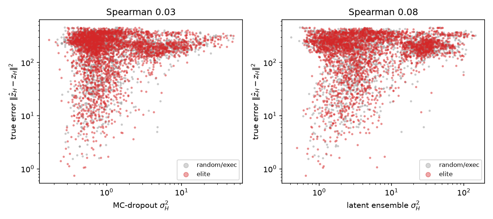
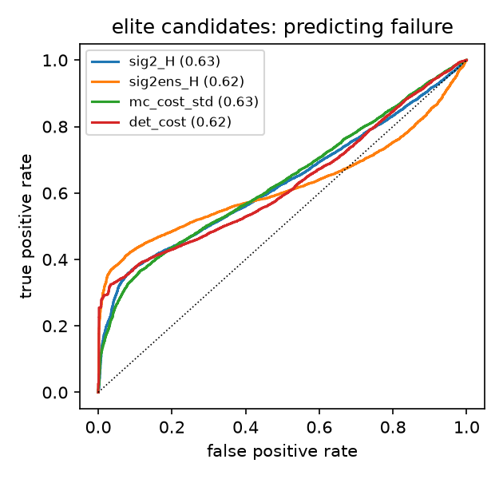
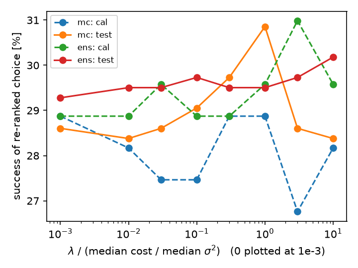
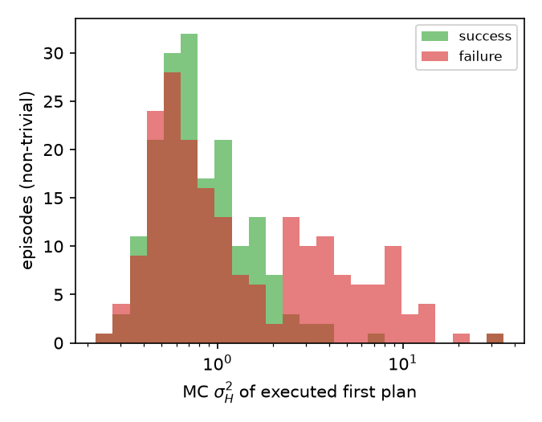

# L1 signal test: is sigma^2 a useful risk signal on OGBench-Cube?

Generated by `scripts/cube/analyze_signal.py` from 12 recorded baseline runs (600 episodes, 807 planning calls, 41157 replayed candidates). Signals: mc = MC-dropout, ens = latent ensemble.

**Verdict: MC-dropout WEAK-SIGNAL, latent ensemble GO**

## Protocol checks

- Oracle replay fidelity: executed plan replayed vs. state the evaluation reached, max |Δqpos| = 0.0 over 412 transitions (start-of-episode plans: 0.0 over 207; mid-episode plans: 0.0 over 205)
- Oracle vs. closed-loop outcome: 100.0% agreement over 600 episodes
- Trivial first plans (cube already within 4 cm): 36.8%
- Baseline success: all 65.8%, non-trivial 46.2%, trivial 99.5%

## Q1 Is the planner's cost a good ranking of real outcomes?

- Spearman(LeWM cost, final cube distance): pooled 0.393 CI [0.340, 0.444], within-plan mean 0.034
- AUROC(LeWM cost -> failure): pooled 0.641 CI [0.613, 0.671], within-plan 0.556 (180 mixed plans)

## Q2 Does sigma^2 track the planner's true prediction error?

Spearman between sigma^2 at block k and ||ẑ_k − z_k||² (pooled, plan-bootstrap 95% CI; within-plan mean).

| block k | MC-dropout | latent ensemble |
|---|---|---|
| 1 | 0.555 [0.508, 0.605]; 0.278 | 0.686 [0.645, 0.722]; 0.422 |
| 2 | 0.452 [0.394, 0.502]; 0.167 | 0.592 [0.548, 0.638]; 0.266 |
| 3 | 0.358 [0.297, 0.412]; 0.105 | 0.517 [0.467, 0.563]; 0.158 |
| 4 | 0.258 [0.189, 0.315]; 0.056 | 0.400 [0.323, 0.453]; 0.078 |
| 5 | 0.032 [-0.029, 0.092]; 0.038 | 0.084 [0.007, 0.151]; 0.056 |
| |cost − true cost| | 0.040 [-0.023, 0.103] | 0.092 [0.012, 0.157] |

Median terminal prediction error: pretrained 206.815, ensemble mean 205.507

## Q3 Among CEM elites, does sigma^2 flag the candidates that fail?

Elite failure rate (non-trivial plans): 71.4%

| score | AUROC | 95% CI (plan bootstrap) | within-plan mean | plans with mixed outcome |
|---|---:|---|---:|---:|
| sig2_H | 0.628 | [0.592, 0.662] | 0.492 | 158 |
| sig2ens_H | 0.618 | [0.584, 0.657] | 0.524 | 158 |
| sig2_1 | 0.453 | [0.415, 0.494] | 0.523 | 158 |
| mc_cost_std | 0.634 | [0.600, 0.668] | 0.518 | 158 |
| det_cost | 0.624 | [0.588, 0.661] | 0.535 | 158 |

MC-dropout: adding sigma^2_H to the LeWM cost in a logistic failure model (grouped 5-fold CV): AUROC 0.620 -> 0.623 (gain 0.003, CI [-0.004, 0.012])

latent ensemble: adding sigma^2_H to the LeWM cost in a logistic failure model (grouped 5-fold CV): AUROC 0.620 -> 0.618 (gain -0.002, CI [-0.014, 0.011])

## Q4 Episode level (executed first plan, non-trivial episodes)

Episodes: 379, failure rate 53.8%

| predictor | AUROC (failure) | 95% CI |
|---|---:|---|
| first_exec_sig2_H | 0.603 | [0.546, 0.660] |
| first_exec_sig2ens_H | 0.564 | [0.501, 0.624] |
| first_exec_det_cost | 0.566 | [0.505, 0.626] |
| first_exec_mc_cost_std | 0.582 | [0.522, 0.640] |
| first_elite_cost_std | 0.476 | [0.413, 0.531] |
| first_start_dist | 0.615 | [0.560, 0.668] |

MC-dropout on top of cost + start distance (CV): AUROC 0.553 -> 0.548

latent ensemble on top of cost + start distance (CV): AUROC 0.553 -> 0.593

## Q5 Re-ranking the replayed candidates with a sigma^2 penalty

### MC-dropout: argmin(mc_cost + lambda * sigma^2_H)

lambda = multiplier x 6.74 (median cost / median sigma^2, calibration seeds); selected multiplier 0.0 (lambda* = 0).

| multiplier | 0.0 | 0.01 | 0.03 | 0.1 | 0.3 | 1.0 | 3.0 | 10.0 |
|---|---:|---:|---:|---:|---:|---:|---:|---:|
| calibration | 28.9% | 28.2% | 27.5% | 27.5% | 28.9% | 28.9% | 26.8% | 28.2% |
| test | 28.6% | 28.4% | 28.6% | 29.1% | 29.7% | 30.9% | 28.6% | 28.4% |

cal: 142 non-trivial plans; executed plan 29.6%, argmin cost 28.9%, lambda* 28.9%, best in pool (upper bound) 43.0%; McNemar p = 1 (0 gained / 0 lost)

test: 444 non-trivial plans; executed plan 30.0%, argmin cost 28.6%, lambda* 28.6%, best in pool (upper bound) 41.2%; McNemar p = 1 (0 gained / 0 lost)

### latent ensemble: argmin(det_cost + lambda * sigma^2_H)

lambda = multiplier x 1.79 (median cost / median sigma^2, calibration seeds); selected multiplier 3.0 (lambda* = 5.37).

| multiplier | 0.0 | 0.01 | 0.03 | 0.1 | 0.3 | 1.0 | 3.0 | 10.0 |
|---|---:|---:|---:|---:|---:|---:|---:|---:|
| calibration | 28.9% | 28.9% | 29.6% | 28.9% | 28.9% | 29.6% | 31.0% | 29.6% |
| test | 29.3% | 29.5% | 29.5% | 29.7% | 29.5% | 29.5% | 29.7% | 30.2% |

cal: 142 non-trivial plans; executed plan 29.6%, argmin cost 28.9%, lambda* 31.0%, best in pool (upper bound) 43.0%; McNemar p = 0.508 (6 gained / 3 lost)

test: 444 non-trivial plans; executed plan 30.0%, argmin cost 29.3%, lambda* 29.7%, best in pool (upper bound) 41.2%; McNemar p = 0.845 (14 gained / 12 lost)

## Q6 Why do executed plans fail?

Selection failure = another replayed candidate (of the executed plan, 30 elites, 20 randoms) solves the task; search failure = none does. Cost gap = true latent cost − predicted cost of the executed plan (median).

| plans | n | executed success | failures | selection failures | search failures | cost gap (failed) | cost gap (succeeded) |
|---|---:|---:|---:|---:|---:|---:|---:|
| all | 586 | 29.9% | 411 | 16.8% | 83.2% | 252.132 | 45.512 |
| first_plan | 379 | 45.6% | 206 | 29.1% | 70.9% | 235.865 | 45.512 |
| second_plan | 207 | 1.0% | 205 | 4.4% | 95.6% | 265.520 | 81.214 |

## Figures

