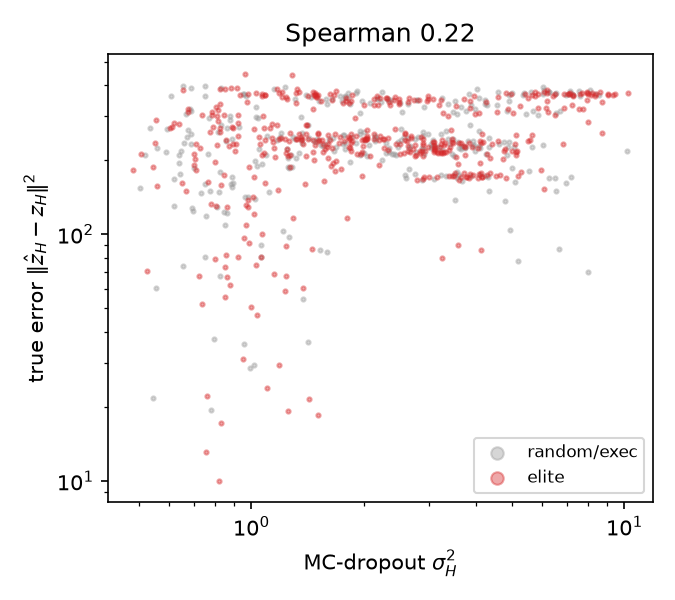
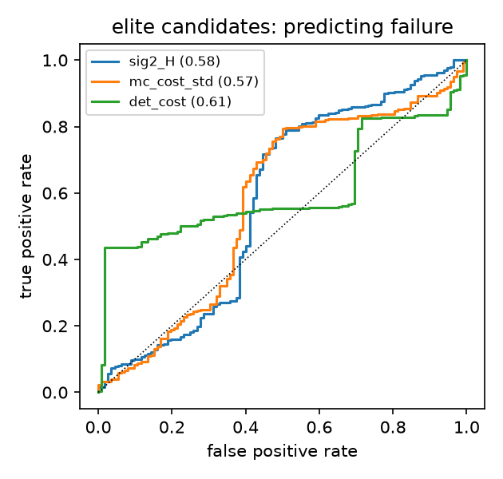
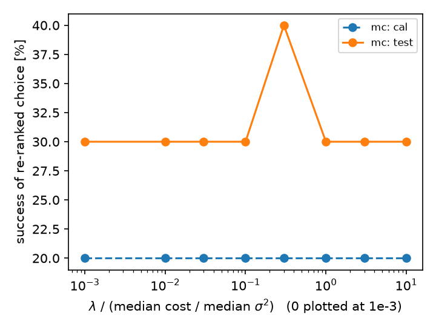
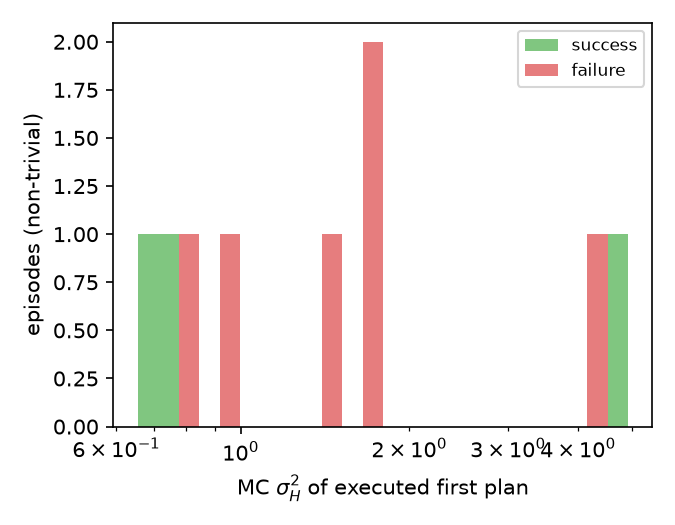

> **Sandbox pilot on 16 synthetic episodes — pipeline check only, not a result** (see README.md in this folder).

# L1 signal test: is sigma^2 a useful risk signal on OGBench-Cube?

Generated by `scripts/cube/analyze_signal.py` from 2 recorded baseline runs (16 episodes, 22 planning calls, 1122 replayed candidates). Signals: mc = MC-dropout.

**Verdict: MC-dropout NO-GO**

## Protocol checks

- Oracle replay fidelity: executed plan replayed vs. state the evaluation reached, max |Δqpos| = 2.5153895061302833e-07 over 6 transitions
- Oracle vs. closed-loop outcome: 100.0% agreement over 16 episodes
- Trivial first plans (cube already within 4 cm): 43.8%
- Baseline success: all 62.5%, non-trivial 33.3%, trivial 100.0%

## Q1 Is the planner's cost a good ranking of real outcomes?

- Spearman(LeWM cost, final cube distance): pooled 0.407 CI [0.132, 0.604], within-plan mean -0.038
- AUROC(LeWM cost -> failure): pooled 0.623 CI [0.417, 0.814], within-plan 0.416 (6 mixed plans)

## Q2 Does sigma^2 track the planner's true prediction error?

Spearman between sigma^2 at block k and ||ẑ_k − z_k||² (pooled, plan-bootstrap 95% CI; within-plan mean).

| block k | MC-dropout |
|---|---|
| 1 | 0.045 [-0.521, 0.550]; 0.202 |
| 2 | 0.190 [-0.289, 0.665]; 0.233 |
| 3 | 0.149 [-0.348, 0.678]; 0.000 |
| 4 | 0.015 [-0.426, 0.504]; -0.007 |
| 5 | 0.223 [-0.186, 0.571]; 0.033 |
| |cost − true cost| | 0.309 [-0.100, 0.623] |

## Q3 Among CEM elites, does sigma^2 flag the candidates that fail?

Elite failure rate (non-trivial plans): 75.1%

| score | AUROC | 95% CI (plan bootstrap) | within-plan mean | plans with mixed outcome |
|---|---:|---|---:|---:|
| sig2_H | 0.575 | [0.217, 0.904] | 0.602 | 6 |
| sig2_1 | 0.630 | [0.282, 0.863] | 0.553 | 6 |
| mc_cost_std | 0.574 | [0.252, 0.885] | 0.670 | 6 |
| det_cost | 0.605 | [0.362, 0.842] | 0.545 | 6 |

MC-dropout: adding sigma^2_H to the LeWM cost in a logistic failure model (grouped 5-fold CV): AUROC 0.100 -> 0.160 (gain 0.060, CI [-0.007, 0.211])

## Q4 Episode level (executed first plan, non-trivial episodes)

Episodes: 9, failure rate 66.7%

| predictor | AUROC (failure) | 95% CI |
|---|---:|---|
| first_exec_sig2_H | 0.667 | [0.000, 1.000] |
| first_exec_det_cost | 0.444 | [0.000, 0.850] |
| first_exec_mc_cost_std | 0.444 | [0.000, 0.875] |
| first_elite_cost_std | 0.500 | [0.000, 0.898] |
| first_start_dist | 0.556 | [0.057, 1.000] |

MC-dropout on top of cost + start distance (CV): AUROC 0.056 -> 0.000

## Q5 Re-ranking the replayed candidates with a sigma^2 penalty

### MC-dropout: argmin(mc_cost + lambda * sigma^2_H)

lambda = multiplier x 6.85 (median cost / median sigma^2, calibration seeds); selected multiplier 0.0 (lambda* = 0).

| multiplier | 0.0 | 0.01 | 0.03 | 0.1 | 0.3 | 1.0 | 3.0 | 10.0 |
|---|---:|---:|---:|---:|---:|---:|---:|---:|
| calibration | 20.0% | 20.0% | 20.0% | 20.0% | 20.0% | 20.0% | 20.0% | 20.0% |
| test | 30.0% | 30.0% | 30.0% | 30.0% | 40.0% | 30.0% | 30.0% | 30.0% |

cal: 5 non-trivial plans; executed plan 20.0%, argmin cost 20.0%, lambda* 20.0%, best in pool (upper bound) 60.0%; McNemar p = 1 (0 gained / 0 lost)

test: 10 non-trivial plans; executed plan 20.0%, argmin cost 30.0%, lambda* 30.0%, best in pool (upper bound) 50.0%; McNemar p = 1 (0 gained / 0 lost)

## Q6 Why do executed plans fail?

Selection failure = another replayed candidate (of the executed plan, 30 elites, 20 randoms) solves the task; search failure = none does. Cost gap = true latent cost − predicted cost of the executed plan (median).

| plans | n | executed success | failures | selection failures | search failures | cost gap (failed) | cost gap (succeeded) |
|---|---:|---:|---:|---:|---:|---:|---:|
| all | 15 | 20.0% | 12 | 41.7% | 58.3% | 276.664 | 79.794 |
| first_plan | 9 | 33.3% | 6 | 66.7% | 33.3% | 260.993 | 79.794 |
| second_plan | 6 | 0.0% | 6 | 16.7% | 83.3% | 326.639 | n/a |

## Figures

