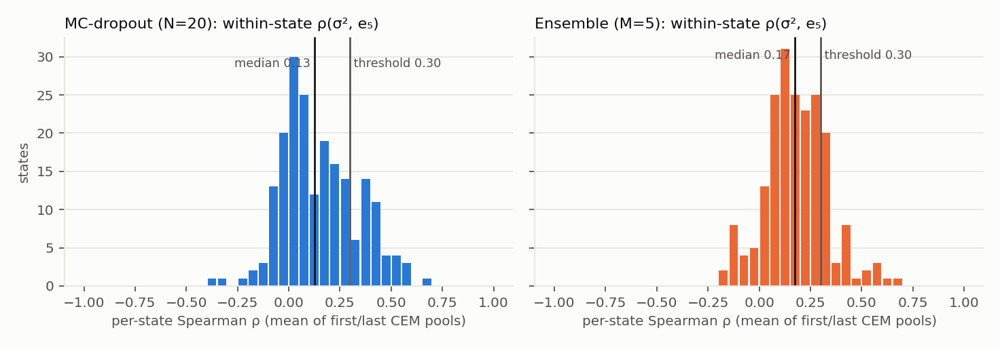
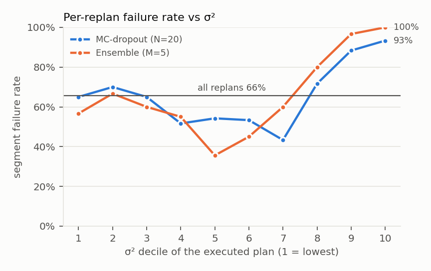
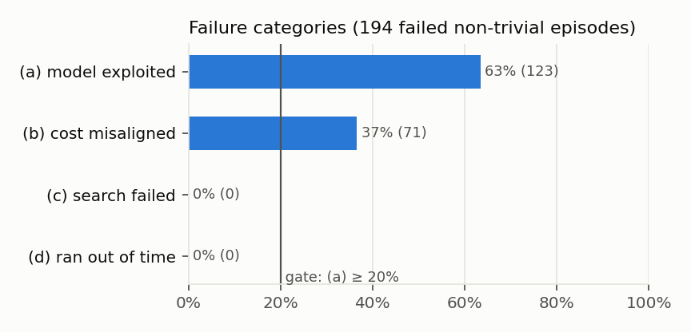

# Step 1 result: does σ² separate failures on Cube?

**Decision: B**: neither MC-dropout nor ensemble sigma^2 passes C1-C3.

Protocol and thresholds: [docs/step1_preregistration.md](../../../docs/step1_preregistration.md). All numbers below come from `scripts/step1_decide.py`.

## Closed loop (baseline LeWM, non-trivial starts)

| seed | 61 | 62 | 63 | 64 | 65 | 66 | 67 | 68 | all |
|---|---:|---:|---:|---:|---:|---:|---:|---:|---:|
| success | 48% | 62% | 58% | 48% | 52% | 54% | 52% | 38% | **51.5%** (206/400) |

599 replans; 393 segment failures. Replay determinism: {61: {'n': 27, 'max_abs_pos_m': 0.0, 'max_abs_emb': 6.67572021484375e-06}, 62: {'n': 19, 'max_abs_pos_m': 0.0, 'max_abs_emb': 3.933906555175781e-06}, 63: {'n': 21, 'max_abs_pos_m': 0.0, 'max_abs_emb': 5.245208740234375e-06}, 64: {'n': 26, 'max_abs_pos_m': 0.0, 'max_abs_emb': 4.76837158203125e-06}, 65: {'n': 24, 'max_abs_pos_m': 0.0, 'max_abs_emb': 7.867813110351562e-06}, 66: {'n': 23, 'max_abs_pos_m': 0.0, 'max_abs_emb': 5.7220458984375e-06}, 67: {'n': 26, 'max_abs_pos_m': 0.0, 'max_abs_emb': 4.76837158203125e-06}, 68: {'n': 33, 'max_abs_pos_m': 0.0, 'max_abs_emb': 5.0067901611328125e-06}}; segment labels from closed loop and replay agree on 100.0% of replans.

## Pre-registered criteria

| criterion | threshold | MC-dropout (N=20) | Ensemble (M=5) | MC-dropout (N=5) *(sensitivity)* |
|---|---|---|---|---|
| C1 median within-state ρ | ≥ 0.30 | ❌ 0.125 [0.08, 0.16] | ❌ 0.174 [0.15, 0.20] | ❌ 0.103 [0.07, 0.12] |
| C1 states with ρ > 0 | ≥ 70% | ✅ 80% | ✅ 90% | ✅ 78% |
| C2 headroom share | ≥ 20%, CI > 0 | ❌ +0.0% [-11.8%, +20.6%] | ✅ +23.6% [+10.6%, +38.7%] | ❌ -1.1% [-14.7%, +21.1%] |
| C3 AUROC(σ² → segment failure) | ≥ 0.65 | ❌ 0.587 [0.53, 0.64] | ✅ 0.659 [0.61, 0.71] | ❌ 0.597 [0.54, 0.65] |
| C3 ΔAUROC over cost-only | CI > 0 | ✅ +0.013 [+0.001, +0.025] | ❌ +0.004 [-0.009, +0.016] | ✅ +0.009 [+0.000, +0.019] |
| **passes C1–C3** |  | **❌** | **❌** | **❌** |

Cost-only AUROC (log d_pred, log d₀): 0.675. Base rate: 393/599 segments fail.

## Gate G: failure categories

τ (90th pct of d_real over 19644 replays that end at the goal) = 297.62.

| category | count | share |
|---|---:|---:|
| (a) model exploited: d_pred ≤ τ < d_real | 123 | 63% |
| (b) cost misaligned: d_real ≤ τ | 71 | 37% |
| (c) search failed | 0 | 0% |
| (d) ran out of time: final ≤ 50% initial | 0 | 0% |

Gate (a) ≥ 20%: **✅**

## Headroom (C2) details, last CEM pool

| | MC-dropout (N=20) | Ensemble (M=5) | MC-dropout (N=5) |
|---|---|---|---|
| mean headroom o(base) − o(oracle), cm | 3.6 | 3.6 | 3.6 |
| states with headroom > 0 | 97/200 | 97/200 | 97/200 |
| success: baseline pick / physical oracle | 38% / 57% | 38% / 57% | 38% / 57% |
| share captured by latent oracle (argmin d_real) | +62.9% | +62.9% | +62.9% |
| λ chosen (cross-fit counts) | 0.1:84, 0.25:40, 0.5:50, 1.0:17, 2.0:8, 4.0:1 | 0.25:1, 0.5:22, 1.0:82, 2.0:95 | 0.1:25, 0.25:12, 0.5:30, 1.0:75, 2.0:24, 4.0:34 |
| decision-change rate at modal λ | 46% | 87% | 92% |

## Sensitivity (does not change the decision)

| | MC-dropout (N=20) | Ensemble (M=5) | MC-dropout (N=5) |
|---|---|---|---|
| median ρ, first CEM pool | 0.145 | 0.244 | 0.130 |
| median ρ, last CEM pool | 0.092 | 0.126 | 0.069 |
| episode AUROC (max σ² → failure) | 0.657 [0.60, 0.71] | 0.779 [0.73, 0.83] | 0.676 [0.62, 0.73] |

Ensemble with errors of its own mean prediction: median within-state ρ 0.183, ρ > 0 in 81% of states.

Ensemble members, held-out 1-step loss: 0.0041, 0.0041, 0.0041, 0.0041, 0.0041 (released predictor 0.0045).

## Figures

